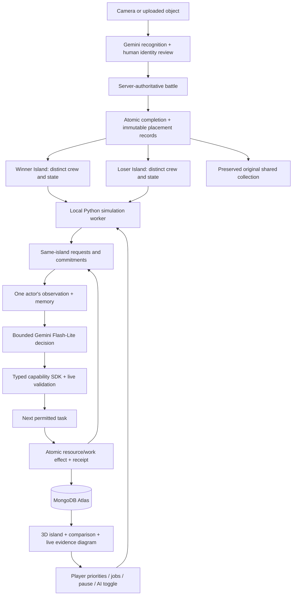
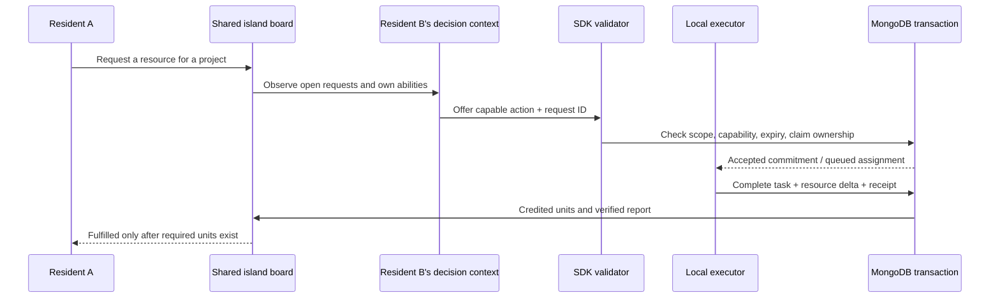

# Sketch Clash: two colonies and a shared board

Implemented 24 October 2026. The game asks whether a useful combination of objects can build a better island than a collection of battle winners. It does not assume winners are expensive, or that observed progress proves a causal benefit from AI communication.

## Current system



Every completed battle records both accepted fighter slots. Winner and loser placement follows the authoritative `winner_slot`, never model prose or price. One canonical object type has one persistent resident **per side**; repeat appearances add placement history without replacing its first appearance. The same type may exist on both sides. Existing battles are backfilled chronologically and idempotently. The original `worldCharacters` collection remains separate.

Accepted identities now select 18 recognizable procedural silhouettes, including televisions, microwaves, pitchers and rulers. This presentation upgrade also improves coarse legacy templates while retaining their identity, palette, accessories and scale; genuine book/unknown templates retain their existing shape.

Each side starts with the same resources and building definitions. Its crew composition, timing and player interventions may differ. Four buildings have three levels; tasks, XP, bounded memories, resources and completed projects survive restart. The scene uses one active WebGL canvas, switches shores, and exposes roster controls independently of picking a 3D mesh.

## What “agents talk” means here



Routine rules can post and answer requests without an API call; these entries are marked **game rule**. A Gemini turn can post a structured request, claim suitable work, select a permitted next action or report its own completed receipt. These entries are marked **AI**. Offers are intentions. Only the executor's committed receipt proves the simulated resource/work change. Model-written interpretation is never treated as evidence by itself.

The board is a blackboard coordination pattern: agents see their own island's shared requests and use independent contexts. It is not an unbounded conversational roleplay, a separate operating-system process per object, or a hidden chain-of-thought viewer. The interactive diagram shows the actual observation, public intent, validator outcome, task and receipt, including errors and missing evidence.

The economy credits production into shared stock. It does **not** track physical water in a vessel, pairwise physical delivery, collision avoidance, reachability or conservation of finite source deposits. The grove, cistern, planning desk and charging dock are declared game sources. Movement is animated from authoritative task positions and times.

## Capability SDK

`backend/app/agent_sdk.py` provides `AgentDecision`, `BoardMessage`, `capability_profile`, `resource_actions` and `validate_decision`. Pydantic rejects extra fields. `ColoniesStore.observation(colony_id, actor_id)` and `apply_decision(colony_id, actor_id, decision, run_id)` are the integration boundary. This is an internal Python SDK, not a published package.

An example proposal (IDs come from an actual observation):

```python
AgentDecision(
    action='water',
    reason='The garden needs water; my vessel can collect it.',
    claim_request_id=observed_request_id,
    message=BoardMessage(kind='offer', request_id=observed_request_id,
                         text='I can collect water for the garden.')
)
```

A dry bag cannot choose water; a mug can. A pencil or ruler supplies ideas through planning/measuring. A lamp observes signals; it does not generate electricity. A battery collects energy at a charging dock. All sentient game objects can move, gather basic materials and assist construction. These are declared gameplay affordances inferred from the **accepted identity**, not empirically discovered physics or an unconstrained interpretation of a nickname. Unknown objects receive basic abilities.

The validator checks actor/island ownership, accepted actions, project IDs, open request/expiry, exclusive commitments and real own-actor report receipts inside the transaction. A model receives no arbitrary database, network, shell or code-execution tool. A decision is durably keyed to its run; retries cannot duplicate its effects. Current work completes before a newly assigned task begins. Capabilities cannot be edited by the model or by a valuation.

## Runtime and storage

| Collection | Authority |
|---|---|
| `battles`, `colonyPlacements` | Accepted fighters, recorded outcome, immutable routing |
| `colonyResidents` | First identity/appearance on each side; repeat participation |
| `colonyModes` | Explicit activation of two-island simulation |
| `islandState`, `islandAgents` | Scoped resources, projects, tasks, persona, memory, contributions |
| `islandEvents` | Scoped action receipts and command journal |
| `colonyBoard`, `colonyCommitments` | Requests, exclusive accepted work, expiry and fulfillment |
| `colonyDecisions`, `colonyContributions` | Validated proposals and actual credited cooperative units |
| `colonyPlanner`, `colonyReasoning` | Scheduling, independent model runs, output and recovery |
| `islandPlanner` | Shared daily usage counter, including prior legacy requests |
| `colonyEstimates` | Explicit user GBP estimates and provenance |

MongoDB Atlas stores state and provides transactions and indexes. Python executes the workers locally. The existing Atlas Vector Search for recognition remains separate; the colony loop does not pretend ordinary reads are Vector Search. No extra tier, Stream Processing service or hosted worker is provisioned by this increment.

Default limits: 40 active residents per side, 120-second offline catch-up, 1,000 units per resource, 5-second worker interval, 3-second visible polling, 5-minute board-request expiry, 8 units per request, 16 open requests. History remains durable; the UI shows bounded recent windows.

Both colonies and prior original-island model usage share a default 24 provider requests per UTC day (`COLONY_REQUESTS_PER_DAY`, clamped 1–240). An automatic turn is due every 15 minutes, alternating sides and selecting a least-recently-served actor. Manual requests have a 60-second cooldown. At most one colony turn is pending. Each call reserves 7,000 tokens, has at most 20,000 input characters and 768 output tokens, and uses the official Gemini Interactions API with `store=False` and no automatic transport retry. The daily token figure is a conservative application reservation, not a billing estimate or guaranteed provider price.

A successful response is persisted before applying it. Local persistence retries reuse that saved decision; they never call Gemini again. Unknown provider outcomes remain charged to the application allowance and block automatic calls. A stale game-state conflict records rejection and waits for the next scheduled turn. Restart marks a provider call that was running as uncertain. Local simulation continues when AI is disabled, unconfigured or out of allowance.

The browser and API bind to localhost. An existing SSH/Tailscale tunnel can forward the frontend; the home Mac remains the Atlas client. The computer and backend must stay awake for continuous simulation. No deployment or paid infrastructure change is included.

## Price and thriving

The UI shows building levels, completed tasks, per-resident task count, fulfilled requests, cooperative resource units and capability gaps. Completed-task counts include rest and therefore are not a productivity score. Building progress and fulfilled useful requests are more meaningful outcomes. Equal starting resources do not remove unequal crew sizes, unlock times or user intervention.

Price estimates are optional manual GBP values, displayed with the number of valued residents. Missing values remain unknown. Estimated means/totals never masquerade as verified market prices. No eBay scraping or invented price feed runs, and no price changes combat, powers, routing or resource yields.

To investigate whether communication helps rather than simply decorate the demo, a future evaluation should replay the same initial crews/seeds under independent rules, shared-board rules and shared-board model decisions. Measure construction time, useful resource production, blocked time, unfulfilled requests and model cost. Report the baseline and negative results. The earlier architecture draft's finite-cargo nursery experiment remains future work.

## Demo path

1. Enter the islands; start once if not already initialized.
2. Switch shores and show the actual crew composition and capability gaps.
3. Select a building and an object. Its task, declared abilities and memory explain its role.
4. Open the shared board. Follow a request to its offer and actual contribution receipt.
5. Inspect **Under the hood**. Trigger one actor turn if quota/cooldown permit; show acceptance or rejection honestly.
6. Compare both shores, including estimate coverage if values were entered.
7. Reload to show persistence. Closing the browser leaves the local worker running; stopping the backend does not.

No automatic AI improvement, real-world physical understanding, causal cooperation advantage or price/performance conclusion has been established by these mechanics alone.
