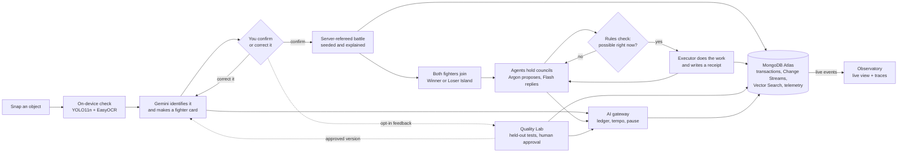

# Sketch Clash

**Photograph an everyday object, battle a friend, then watch it live on an island run by AI agents.**

Sketch Clash turns play into evidence about real objects. Gemini recognises your photo, you confirm or correct it, a server-refereed battle decides the winner, and both objects become long-running agents that discuss, plan and build together. MongoDB Atlas remembers everything.

> Research question: *can human feedback help AI create more reliable and useful digital representations of real-world objects?*

## Live demo

**[https://web-production-42890.up.railway.app](https://web-production-42890.up.railway.app)** is hosted on Railway for judging and may be taken down afterwards.

| | |
| --- | --- |
| Username | `judge` |
| Password | `clash-197dd1d4` |

Press **PLAY OBJECT BATTLE** to start a camera battle; the browser asks for camera permission. **ENTER THE ISLANDS** shows the agents, and **Observatory** shows live events.

## How it works



## Highlights

- **Evidence-checked recognition.** YOLO11n and EasyOCR run on-device first, and their output is treated as untrusted evidence. Gemini 4 Argon or 3.8 Flash then proposes an identity, strict schema checks validate it, and the player confirms it. A correction triggers a fresh look instead of becoming truth.
- **Fair, explainable battles.** The server owns every hit, using seeded combat with a receipt for each one. A 342,000-battle balance audit keeps win rates between 40% and 57%.
- **Long-running agents.** Two islands keep working with the browser closed. Councils need at least two residents to agree, a rules engine checks every plan, and only completed work with a receipt counts. Agents can run simulated experiments and turn passing designs into blueprints.
- **AI rate limiting.** Every Gemini call is reserved in a shared Atlas ledger before it's sent, so limits hold across workers and survive restarts.
  - Island agents have a tempo dial (Slow, Steady or Fast: 1, 2 or 4 calls a minute), one call in flight and a rolling 24-hour budget.
  - Player requests get their own slots, so they never wait behind agents.
  - The engine's scheduler ticks every 5 seconds, so routine island work continues without any AI calls.
  - SDK retries are off, uncertain calls are never blindly repeated, and pause switches stop everything.
- **OpenTelemetry.** FastAPI, PyMongo and agent operations are traced. Sanitized spans and per-minute metrics are exported to Atlas, expire after 7 and 30 days, and are linked from the Observatory next to the live event stream.
- **MongoDB Atlas as shared memory.**
  - Multi-document transactions save each change, its receipt and its event together.
  - Change Streams feed the live Observatory over SSE.
  - Two Vector Search indexes cover object types and reviewed photos.
  - Pipeline versions are immutable, with an atomic pointer to the active one.
- **Human-gated improvement.** Only opt-in feedback reaches the Quality Lab. A candidate is tested on held-out photos grouped by physical object, and a person must switch it on.
- **Secure by default.**
  - Everything runs locally on `127.0.0.1`.
  - The Docker containers have read-only filesystems with no extra Linux capabilities, behind a strict Content-Security-Policy.
  - The Quality Lab is behind an operator key.
  - An optional page password (`SITE_PASSWORD`) protects hosted copies.

## Run it yourself with Docker

You need Docker and about 5 GB of free disk. A Gemini key and a MongoDB Atlas cluster are optional.

```bash
git clone https://github.com/Sukhraj1000/sketch-clash.git
```

```bash
cd sketch-clash
```

**Without any accounts.** Data stays in memory; you get the demo, the ready-made object arena and the island playground.

```bash
docker compose -f compose.yaml -f compose.demo.yaml up --build -d
```

**Full version.** Copy `.env.example` to `.env.local`, set `GEMINI_API_KEY` and `MONGODB_URI`, and allow your IP in Atlas. Then:

```bash
docker compose up --build -d
```

Open **[http://127.0.0.1:8080](http://127.0.0.1:8080)**, using exactly this address. The first build takes a few minutes. `docker compose logs -f` shows the logs and `docker compose down` stops everything. The [full reference](docs/REFERENCE.md#quick-start-with-docker-any-computer) has troubleshooting, the Quality Lab key and running without Docker.

## Built with

React 19 · Three.js / React Three Fiber · FastAPI on Python 3.12 · Gemini 4 Argon, 3.8 Flash and Embedding 2 (official `google-genai` SDK, Interactions API) · YOLO11n · EasyOCR · MongoDB Atlas · OpenTelemetry · Docker + nginx · Railway

## Status

793 backend tests pass. The live Atlas Change Stream recovers after restarts, and multi-agent agreement and recovery are verified with deterministic fixtures. No recognition improvement is claimed yet, because no reviewed evaluation cases have been approved.

## More detail

- [Full reference](docs/REFERENCE.md): everything that used to be in this README.
- [Runtime architecture and Observatory](docs/architecture/agent-observatory.md)
- [Islands, councils and the agent SDK](docs/COLONIES_IMPLEMENTATION.md)
- [Quality policy and evaluations](docs/Design.md)
- [Handover and verification log](HANDOVER.md)
