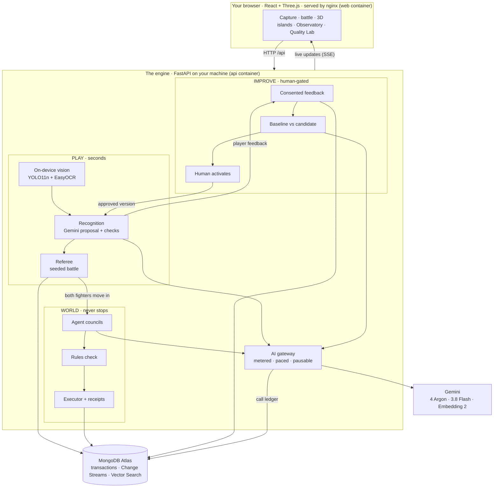
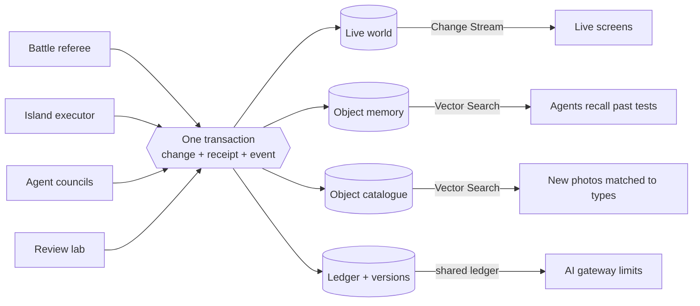

# Sketch Clash

**Making AI’s view of the physical world more reliable through human feedback and interactive play.**

Sketch Clash is a local two-player object battle game with two persistent 3D colonies. Photograph an everyday object, review its identity and fictional character, challenge a friend, then send the winner to Winner Island and the other fighter to Loser Island. Residents gather, build, gain experience and remember their contributions. A separate creator lab investigates recognition failures and requires human approval before adopting pipeline changes.

The research question is **“Can human feedback help AI create more reliable and useful digital representations of real-world objects?”** Storing feedback changes neither Gemini’s weights nor the active pipeline automatically. Intended benefits remain things to measure, not demonstrated improvements.

**Local only.** React/Vite and Python/FastAPI bind to `127.0.0.1`. Your selected photographs and supporting evidence are sent by the backend to Gemini; game records and compact images are stored in MongoDB Atlas. There is no public deployment or public account system. Optional Vercel hosting for the static frontend is configured but not deployed (see [Vercel](#vercel-optional-not-deployed)).

## Live demo

**[https://web-production-42890.up.railway.app](https://web-production-42890.up.railway.app)** is hosted on Railway for judging and may be taken down afterwards.

Your browser asks for a login before showing the page:

| | |
| --- | --- |
| Username | `judge` |
| Password | `clash-197dd1d4` |

The hosted copy is the full app: camera recognition with Gemini, the two islands with their saved residents and conversations in MongoDB Atlas, the Observatory and the object arena. Island agents keep their normal AI limits, and the password stops anyone without it from using the Gemini key. Please use a laptop or phone camera over HTTPS. The page asks for camera permission the first time.

## Quick start with Docker (any computer)

Docker runs the whole app, the 3D game in your browser plus the Python engine behind it, without installing Node, Python or the vision models yourself.

**You need**

- [Docker Desktop](https://www.docker.com/products/docker-desktop/) (or Docker Engine with Compose v2) and about 5 GB of free disk space.
- *Optional:* a [Gemini API key](https://aistudio.google.com/apikey) for photo recognition and the AI agents' discussions.
- *Optional:* a [MongoDB Atlas](https://www.mongodb.com/atlas) cluster so islands, battles and memories are saved between restarts.

### 1. Get the code

The [repository](https://github.com/Sukhraj1000/sketch-clash) is private, so you need access from its owner.

```bash
git clone https://github.com/Sukhraj1000/sketch-clash.git
```

```bash
cd sketch-clash
```

### 2a. Try it without any accounts (demo mode)

```bash
docker compose -f compose.yaml -f compose.demo.yaml up --build -d
```

Open **[http://127.0.0.1:8080](http://127.0.0.1:8080)**. The first build downloads CPU-only PyTorch and the YOLO11n and EasyOCR weights, so it takes several minutes; later starts reuse the cache.

Demo mode keeps everything in memory and forgets it when the containers stop. Without a Gemini key you can still use **WATCH DEMO**, **PLAY OBJECT BATTLE** (ready-made objects) and the **Island Playground**. Camera recognition and the agents' Gemini discussions need a key.

### 2b. Run the full version with your own keys

1. Copy the example settings. `.env.local` is git-ignored and never copied into an image.

   ```bash
   cp .env.example .env.local
   ```

2. Open `.env.local` in an editor and fill in:
   - `GEMINI_API_KEY`: your Gemini key.
   - `MONGODB_URI`: your Atlas connection string. Keep `MONGODB_DATABASE=sketch_clash` or choose your own name.
   - Optional: `SKETCH_AI_PAUSED=true` stops all automatic Gemini calls while you set things up.

   Keep this file private (`chmod 600 .env.local`). Never give a secret a `VITE_` prefix, because that would put it in the browser bundle.
3. In Atlas, allow your computer's public IP under **Network Access** and give the database user read/write access to the database.
4. Start the stack:

   ```bash
   docker compose up --build -d
   ```

5. Open **[http://127.0.0.1:8080](http://127.0.0.1:8080)**. Use exactly this address, because the engine only accepts actions from the page it serves.

### 3. Play

1. **NEW CAMERA BATTLE**: two players photograph objects (the camera works on `127.0.0.1`), check what the AI recognised, then battle.
2. **ENTER THE ISLANDS** → **START BOTH ISLANDS** once. Both fighters move onto Winner Island or Loser Island and keep working as agents.
3. **Observatory** ([/#/observatory](http://127.0.0.1:8080/#/observatory)) shows live events, AI pace controls and saved replays.
4. **Quality Lab** needs a local operator key. The engine creates it on first start in `backend/data/operator-token`. Print it in a private terminal with `cat backend/data/operator-token` (or `npm run operator:token` if you have Node) and paste it into the lab. Never share it in chat or screenshots.

### 4. Everyday commands

| Task | Docker command | npm shortcut |
| --- | --- | --- |
| Start or rebuild | `docker compose up --build -d` | `npm run docker:up` |
| Demo mode (memory only) | `docker compose -f compose.yaml -f compose.demo.yaml up --build -d` | `npm run docker:demo` |
| Status | `docker compose ps` | |
| Follow logs | `docker compose logs -f` | `npm run docker:logs` |
| Stop | `docker compose down` | `npm run docker:down` |

While the AI isn't paused, island agents call Gemini by themselves. By default that's at most 4 calls a minute and 200 a day (`ISLAND_AI_REQUESTS_PER_MINUTE`, `ISLAND_AI_REQUESTS_PER_DAY`). Stop the stack, or set `SKETCH_AI_PAUSED=true` and run `docker compose up -d` again, when you aren't playing.

### Troubleshooting

- **The page loads but says the engine or islands can't be reached.** The `api` container is still starting (its health check allows about 90 seconds) or it stopped. Check `docker compose ps` and `docker compose logs api`. The usual cause is a missing or wrong `MONGODB_URI`, or your IP isn't allowed in Atlas. Fix it, or use demo mode.
- **Port 8080 is already in use.** Change `127.0.0.1:8080:80` in `compose.yaml` and set `FRONTEND_ORIGIN` to the matching address.
- **The build fails partway through.** Free up disk space. A full disk turns Docker's virtual machine read-only mid-build.
- **Linux: the operator key can't be written.** The engine runs as user ID 1000 and writes only to `backend/data`, so that folder must be writable by UID 1000.
- **Optional, meaning search for object types:** set `EMBEDDING_MODEL=gemini-embedding-2` in `.env.local`, restart, then run `docker compose exec api python backend/scripts/setup_retrieval.py`. This needs an Atlas cluster that supports Vector Search.

## How it works



The browser is a thin client. One local engine makes every decision, in three lanes that run at different speeds:

- **Play** (seconds) turns a photo into a checked fighter and a server-refereed battle.
- **World** (never stops) runs the island agents: they discuss plans, the rules check them, and finished work is recorded with receipts.
- **Improve** (human-gated) tests a better recognition pipeline against held-out photos, and only a person can switch it on.

Gemini is reached only through the AI gateway. MongoDB Atlas is the memory everything shares.

### How Gemini is used

| Part of the app | What it sends | Model | What comes back | What checks it |
| --- | --- | --- | --- | --- |
| Camera check | Cropped photo, YOLO boxes, OCR text (as untrusted evidence) | `gemini-4-argon`, or `gemini-3.8-flash` with the `camera-fast-v2` profile | Identity plus a fighter card | Schema and identity validation (at most two repairs), then the player |
| Island councils | One resident's abilities, island stock, evidence dossier and the real earlier messages | `gemini-4-argon` proposes, `gemini-3.8-flash` replies | A typed proposal, support or objection | The rules engine's feasibility check; at least two residents must agree |
| Memory | Catalogue descriptions and reviewed photos | Gemini Embedding 2 (768 dimensions) | Vectors | Stored and searched in Atlas Vector Search |
| Review lab | Reviewed development failures | `gemini-4-argon` in a bounded tool loop | One candidate configuration | Frozen held-out evaluation, then explicit human activation |
| Price check | A short list of curated retailer URLs | `gemini-3.8-flash` with URL Context | Price references | Approved URLs and matching evidence only; otherwise neutral |

Every call uses the official `google-genai` SDK and Interactions API with `store=False` and automatic SDK retries off. The gateway reserves each call in Atlas before sending it, and paces island agents (at most 4 calls a minute and 200 a day by default). It never blindly repeats an uncertain call, honours the pause switches, and keeps the API key on the server.

### How MongoDB Atlas is used



| Atlas feature | What it does here | Example collections |
| --- | --- | --- |
| Multi-document transactions | A change, its receipt and its event commit together or not at all | `islandState`, `islandEvents`, `agentEvents` |
| Change Streams | One backend watcher pushes committed events to the Observatory over SSE, with resync and labelled polling as fallbacks | `agentEvents` |
| Vector Search | Two separate indexes: the object-type catalogue and human-reviewed reference photos | `characterTypes` (`character_types_vector`), `qualityReferenceVectors` (`quality_references_vector`) |
| Object memory | Dossiers keep what was observed apart from assumptions and test results; findings become reusable blueprints | `colonyObjectDossiers`, `colonyFindings`, `colonyBlueprints` |
| Admission ledger | Every Gemini call is reserved atomically across workers and survives restarts | `providerAdmission`, `providerControls` |
| Immutable versions | Pipeline configurations are frozen, with an atomic pointer to the active one | `pipelineVersions`, `qualityState`, `qualityActivation` |
| Telemetry with expiry | Sanitized OpenTelemetry spans and metrics expire after 7 and 30 days | `agentSpans`, `agentMetrics` |

Python runs the agents; Atlas holds the truth across 50+ collections. For more detail, see [the runtime architecture](docs/architecture/agent-observatory.md), [the colonies implementation](docs/COLONIES_IMPLEMENTATION.md) and [the quality policy](docs/Design.md).

## Run without Docker (original development Mac)

Dependencies, vision weights and backend credentials are already configured. Preserve the ignored `.env.local`.

The project lives at `~/Projects/sketch-clash`. Its original Codex `outputs/sketch-clash` location is a compatibility symlink to this same directory, so older saved commands and links still work.

```sh
cd /Users/sukhrajkalon/Projects/sketch-clash
npm run dev
```

Open [http://127.0.0.1:5173/](http://127.0.0.1:5173/). The API listens on port 8000. Use the existing server if those ports are already occupied. `npm run dev:frontend` and `npm run dev:api` start the services separately.

The MacBook can use the same URL through the existing SSH tunnel over Tailscale. Open it in the **MacBook’s own browser** to use its camera. Atlas connections originate from the home Mac, so the home connection’s public egress IP belongs in the Atlas allowlist; the remote MacBook’s IP and Tailscale address do not replace it.

The default repository is MongoDB and fails clearly if unavailable. `npm run dev:demo` explicitly selects temporary memory for development, labelled in the UI; its island disappears on backend restart. It is not a persistence demonstration.

## Docker details

Docker Desktop runs the whole stack without the local `.venv` or vision setup. The `api` image installs CPU-only torch and bakes in the YOLO11n and EasyOCR weights; the `web` image builds the frontend and serves it with nginx, proxying `/api` to the backend.

```sh
npm run docker:up     # docker compose up --build -d
```

Open [http://127.0.0.1:8080/](http://127.0.0.1:8080/). Only that port is published, bound to `127.0.0.1`, so it does not clash with `npm run dev` on 5173/8000. Secrets are read from `.env.local` when the container starts and never enter an image (`.dockerignore` excludes them).

- `npm run docker:demo` uses temporary in-memory records, like `npm run dev:demo`.
- `npm run docker:logs` follows both services; `npm run docker:down` stops them.
- The backend shares `backend/data` with `npm run dev`, so `npm run operator:token` prints the Quality Lab key for both.
- The first build downloads torch and the vision weights and takes several minutes; later builds reuse the cached layers. Keep about 5 GB free: a full disk turns Docker's VM read-only mid-build.
- The stack restarts with Docker Desktop (`restart: unless-stopped`). To keep it running after a reboot, enable Docker Desktop → Settings → General → **Start Docker Desktop when you sign in**.
- While AI is not paused, the island crews call Gemini automatically, bounded by `ISLAND_AI_REQUESTS_PER_DAY` (legacy `GEMINI_REQUESTS_PER_DAY`). Run `npm run docker:down` or set `SKETCH_AI_PAUSED=true` when you are not playing.
- Hardening: only `127.0.0.1:8080` is published; both containers have read-only filesystems, drop all Linux capabilities (nginx keeps the four it needs to bind port 80 and switch user), cannot gain privileges, and have memory, process and log-size limits. The backend runs as a non-root user and the installer is not shipped in the image. nginx sends a strict Content-Security-Policy and related headers; `vercel.json` sends the same set.

## Vercel (optional, not deployed)

Hosting is optional and nothing is deployed: the 2026-10-24 Vercel project was removed. `vercel.json` and `.vercelignore` stay so the static frontend can be deployed again with one command. `.vercelignore` is an allowlist, so only `src`, `public` and the build config are uploaded: never `.env.local`, the backend or model weights.

```sh
npx vercel@65.2.0 deploy --prod
```

Vercel cannot run the backend: its ~1.2 GB of torch/YOLO/EasyOCR dependencies exceed function size limits, and the island and colony loops, observatory SSE stream and operator token file need a long-running process. A frontend-only deployment shows "Local engine disconnected", runs only the in-browser playground, and reports "The islands could not be reached (404)". A working hosted copy needs the `api` image on a container host, a login in front of it (otherwise anyone with the link can spend the Gemini key), and Atlas network access for that host. Then add a rewrite to `vercel.json` so `/api` stays same-origin (the operator cookie and origin check rely on that), and set `FRONTEND_ORIGIN` on the backend to the site's URL:

```json
"rewrites": [{ "source": "/api/:path*", "destination": "https://<backend-host>/api/:path*" }]
```

## Build and demonstrate during the Gemini outage

```sh
npm run dev:offline
```

This optional offline command starts the normal local services with `SKETCH_AI_PAUSED=true`. Atlas still saves the real islands and the local executor still completes valid work. New Gemini recognition, councils, reflections and embeddings are blocked before provider dispatch. Camera battles stay visible with a pause explanation, and **WATCH DEMO** still runs the preset showdown; **PLAY OBJECT BATTLE** opens the new attribute-based fixture arena. The interface shows **Gemini paused**; the separately saved evaluation pause stays in place. This command does not change billing, credentials or model selection.

Open **[Island Playground](http://127.0.0.1:5173/#/playground)** for a separate practice simulation. Add a useful object, inspect its job, watch supplies become construction and compare the two example crews. The board explains rule-based choices and completed contributions. Pause, speed up or reset the practice world. Its state lives only in browser memory: these are example residents, not actual battle outcomes, Gemini discussions or saved Atlas records. The playground also works with the API server stopped while Vite is running.

The live islands now show shared supply shortages, productive tasks and the gains expected when each job completes. The Observatory distinguishes a public plan, a validated action and the saved receipt proving its effect. After the provider recovers, restart without `--offline` to remove the startup pause; the evaluation pause and existing provider-failure records are not automatically cleared. Resume and validate those deliberately before claiming new model-authored conversations.

## Island / Factory appearance

On the **Islands** page, use the **Another perspective** switch above the 3D scene to reveal the factory. It shows the same residents as wheeled industrial robots and the same projects as metal grow racks, fabrication benches, equipment terminals and service walkways. Bevelled surfaces, local room reflections, concrete flooring and muted materials give this view a more realistic workshop appearance; object colours remain as small identification markings. Approved assemblies retain their tested parts, with distinct support, holding and containment fixtures around them. Select a robot to see its original object, capability-based robot module, abilities, current task and contributions in the existing inspector.

The switch is local presentation only: it preserves selection, camera and task motion, adds no model calls or saved world changes, and defaults to Island when the page is reopened. Other pages keep their original appearance. Reduced-motion preferences skip the transition.

The map comes first, with **Built into this world** cards showing saved structures, completed levels and actual delivery bonuses. Selecting a build pans toward its saved site and explains which crew roles can use it. Unfinished construction grants no new benefit; existing levels retain their effects during upgrades. Historical duplicate assemblies are labelled as shared bonuses, not additional yield. One recent useful build is labelled by default; selecting or hovering another reveals its details without covering the map in labels.

Resident travel and work tools follow saved tasks in both views. Between jobs, residents make small ambient strolls around their waiting positions, explicitly labelled as adding no output. These strolls do not call Gemini, write world state or earn resources/XP. Pause stops movement and reduced-motion preferences disable continuous motion. Only completed simulation tasks contribute to the island.

## Object battles while Gemini is paused

Choose **PLAY OBJECT BATTLE** on the home page or open [the object arena](http://127.0.0.1:5173/#/battles). Choose two of twelve illustrated fixtures, inspect their attributes, limitations and conditional matchup effects, then start a battle. These are authored game profiles and **illustrative GBP prices**, not recognized photos or live market appraisals. The new arena requires the local API and configured storage, but no Gemini calls.

All objects start at 100 HP with a 20-point budget across impact, resilience, agility and control. Reusable interactions cover brittle surfaces, cushioning, reach, close grip, rolling, traction, limited water, flexible recovery, precise placement, redirecting a roll, bracing and hooking. Only the strongest positive and strongest negative applicable rules count on a hit, with a combined ±20% bound. Price has one logarithmic damage bonus capped at 1%; it does not increase health or grant abilities. Missing prices disable price bonuses for both fighters.

Both objects commit an action each round, so being animated first cannot steal a turn. Results distinguish knockouts, points decisions and tiebreaks. Equal health compares total impact before the remaining-health cap; only equal impact points use the saved random seed. Each hit carries its stat calculation, applicable rules, price contribution, randomness, rounding and health receipt. **Why this won** shows the recorded result and same-seed comparisons with price or interaction modifiers removed; it does not invent a model explanation.

Atlas saves these immutable practice matches in `arenaBattles`, including complete profiles, rules, price snapshots, seed, receipts and a snapshot digest. The match URL contains its saved ID for refresh/replay. Repeating a request returns the same result, and changing fighters under that request ID is rejected. Fixture battles never unlock island residents. New camera battles use the same attribute combat engine with profiles derived from their own accepted recognition evidence, saved in `battles`. Previously started camera battles keep their original rules, outcomes and island placements. Camera pricing now uses sourced UK retail starter references and optional Gemini URL Context refreshes through an Atlas cache. These are category examples, not appraisals or sold prices. Snapshots freeze with the accepted fighter and persist with the battle; neither a cache refresh nor an expired reference changes an already saved battle.

The checked-in [balance audit](docs/combat-balance-v2.json) covers 342,000 local simulations with 1,000 seeds per pairing or price comparison. Against a uniform mix of the other eleven fixtures, win rates range from 40.04% to 56.75%. Raising only an object’s sample price from £0 to the full £250 cap increased its win rate by at most 4.80 percentage points. These measurements apply to this authored roster, not every possible object. Run `npm run test:combat-v2` for integrity checks or `npm run check:combat-balance` to repeat the longer audit.

### Sourced retail references and Atlas cache

No new account is required. Eleven public retailer references in `backend/data/starter_prices.json` cover everyday ceramic mugs, basic reusable 500 ml water bottles, A5 notebooks, plastic 30 cm rulers and ordinary office scissors. Each retains its direct product URL, price, retailer, review timestamp, short evidence and crawl-freshness caveat. A median of at least two suitable references is used. Known contradictory materials, specialist products, sizes, accessories and unsupported subjects remain unknown. OCR and fictional names do not supply price identity. These narrow references are not a universal object-pricing service.

`priceCache` stores current world/category/GBP/GB references with a 24-hour source-age limit. `priceQuoteSnapshots` retains immutable receipts. Transactional leases prevent duplicate refreshes across processes; restart does not renew expired starters. Five-minute negative caching avoids repeating failed optional lookups. No TTL deletion removes historical battle evidence.

After a known category expires, the existing server-only Gemini client may check only its independently curated product URLs using [URL Context](https://ai.google.dev/gemini-api/docs/url-context), `gemini-3.8-flash`, Interactions, low thinking and `store=False`. Successful retrieval metadata, exact approved URLs, single-item GBP pricing and matching evidence are required. Model estimates are discarded. The provider step is limited to eight seconds and all optional pricing work to ten seconds, including cache waits. Timeout or insufficient evidence gives neutral pricing, preserving recognition. URL Context itself may use an index cache, so this is a checked retailer reference, not a guarantee of live stock or checkout price.

**Google Search grounding is not used.** Its [additional terms](https://ai.google.dev/gemini-api/terms#grounding-with-google-search) prohibit collecting grounded results into a shared price database; the proposed Search-backed cache was replaced by this direct-retailer design. No Search output, queries, suggestions or grounding metadata enter the price collections. The old eBay connector and historical receipts remain readable, but the active capture path does not call eBay.

Pricing uses ordinary foreground admission, independent of island pacing and its daily allowance. Global AI pause still blocks paid refreshes; fresh cached references need no model call. Island agents remain on their saved pace and evaluation pause is independent. Price damage stays capped at **1%**, and if either object is unpriced, **both bonuses are zero**. Source labels, reference links, review times and cache origin appear in the battle receipt. Sourced island coverage stays separate from player estimates. `/api/health` reports the active pricing provider and starter categories without secrets.


## Play and give feedback

1. Choose **NEW CAMERA BATTLE**. New rounds rotate through eight saved briefs: Everyday Objects, Kitchen Crew, Desk Companions, Useful Tools, Animal Kingdom, From Nature, Sport & Play and Ready to Wear. Both players receive the same server-assigned brief. Recognition supplies identity; conservative local rules validate eligibility. A definite mismatch disqualifies that capture with retake/correction available; unknown or conflicting identities require clarification. Replay and retries cannot reroll a theme. Historical rounds retain their unrestricted brief.
2. Pass the device privately to each player. Use camera or upload, select one object and crop or retake if needed. JPEG, PNG and WebP are supported; input limits remain 5 MiB and 24 megapixels, with a 1,600-pixel normalized image. Convert HEIC first.
3. Review the **source photograph beside the actual procedural 3D preview**. Answer **Correct**, **Correct it**, or **Not sure**. Factual corrections re-examine the photograph; they are suggestions, not unquestioned ground truth.
4. Optionally choose **Keep** or **Change details**, with reasons and a short comment. Skipping creative feedback is not a negative rating. Style revisions preserve the accepted factual evidence used for combat; appearance is not a way to gain combat power. The original proposal and correction lineage remain recorded.
5. Optionally opt in to reviewed evaluation/reference use of this object photo and feedback. This checkbox starts **off**. Declining does not affect gameplay. Player consent alone does not approve a dataset case.
6. **Lock in my fighter**, then pass the device. Feedback is tied to the exact output and pipeline version before the winner is known. Failed feedback saves are labelled honestly; a valid fighter can continue without a false saved claim.
7. Watch the recorded battle and enter the islands after completion is confirmed. The winner joins Winner Island and the other fighter joins Loser Island. Each side retains one resident per canonical object type; repeated appearances preserve that side’s original identity and history. The original shared collection is also preserved.

Normal capture time is 60 seconds per player; Quick Clash uses 20. Permission, normalization, recognition and saving pause active timing. Expiry never submits automatically. The camera stops when leaving capture. Refresh recovery includes a private handoff before showing the recovered photograph.

Recognition combines four distinct checks:

1. **Local YOLO11n** proposes supported object classes and boxes. Multiple prominent objects in an uncropped photograph require target selection before Gemini runs.
2. **Local EasyOCR** reads visible text as untrusted evidence, never as instructions or proof of object identity.
3. **Gemini** interprets the selected photograph with the available detector and OCR evidence. The backend validates the character schema, approved appearance and combat configuration separately from image identity.
4. **The player** checks the proposed identity before locking in the fighter. Corrections trigger another image review; an incorrect detector label or a player's suggestion cannot silently become ground truth.

After cropping, YOLO, OCR and Gemini all receive the same selected region. Detection boxes returned to the interface are translated back into the original photograph's coordinates. The review explicitly distinguishes compatible labels, different labels, no detections and unavailable local evidence. YOLO11n's installed vocabulary has 80 classes and does not include every everyday object—for example, it has no microphone class. An unsupported class can still be interpreted by Gemini; the interface discloses that YOLO cannot independently confirm it. Neither matching labels nor detector scores establish calibrated certainty.

The built-in `camera-fast-v2` profile uses Gemini 3.8 Flash with low thinking, exact catalogue names/aliases and all existing validation and player review. It skips optional semantic embedding/template-review calls on the interactive path. Enable it explicitly with `npm run enable:recognition-fast`; it changes only new battles and refuses to replace a custom active pipeline. Existing rounds keep their pinned model. This is an engineering latency repair, not a measured recognition-accuracy improvement.

Player requests run normally: they have no artificial dispatch timer or application minute/day allowance. They use a small, independent concurrency bound so an active island discussion cannot occupy their slots. The island speed control applies only to island agents. Real provider cooldowns still apply to every request. Capture latency can include local processing, an occupied normal-request slot, Gemini inference and any required repair. Saved progress distinguishes local YOLO, OCR, queued admission, Gemini response, validation and saving. Queue and provider durations are recorded separately. Initial capture progress uses read-only polling; selection/correction keep their existing recovery flow.

Capture preparation, selection and correction requests wait for at most ten minutes in the browser; ordinary API calls retain their shorter bound. A capture upload that loses its connection or reaches that bound gets one read-only recovery attempt, lasting at most 15 seconds, using the same capture ID. This recovery never automatically repeats the paid capture POST. If processing is still pending, use **Retry this photograph** to recover that capture instead of uploading another copy. The elapsed wait is shown and capture timing stays paused. Longer waiting does not increase Gemini's request pace or clear the evaluation pause.

New camera battles use impact, resilience, agility and control with the same 20-point budget and 100 HP for every fighter. The backend derives supported traits conservatively from accepted object evidence, records the basis for each trait and freezes both combat profiles when the battle starts. A container label alone does not grant stored water; unknown material and price stay unknown. The old Quick, Power and Guard fields remain for saved appearance compatibility and historical rounds, but do not determine new camera battle damage.

The server owns attacks, damage and winner. The result screen explains the saved outcome, conditional rules and damage receipts, with same-seed comparisons removing price and matchup effects. Replay and refresh use the recorded result without extra unlocks; historical v1 rounds are labelled without fabricating v2 explanations. Normal/reduced battles last 12.8 seconds; Quick Clash lasts 6.4 seconds. **WATCH DEMO** remains the original scripted cinematic, with no recognition or island progression.

## Two islands, one rivalry

Choose **ENTER THE ISLANDS**, then **START BOTH ISLANDS** once. Existing completed battles are enrolled using their recorded outcomes; future completed battles route both fighters atomically. The original island remains accessible through **Original island**.

- Switch between Winner Island and Loser Island. Each has its own crew, resources, projects, board and history. Set a building priority, select an object in the 3D scene or roster, follow it, or assign an allowed job.
- Objects contribute through declared game capabilities: containers move supplies, suitable vessels collect water, stationery plans or measures, electronics observe signals, and batteries collect energy at a charging dock. All animated residents can move, gather basic materials and assist construction. A missing specialist creates a visible capability gap.
- Same-island agents post requests, accept commitments and produce resources. The board links each verified contribution to an actual completed action receipt. A message alone cannot create resources or claim success.
- **Under the hood** shows observation → memory → public intent → validation → task → receipt, plus real board connections. Rules, AI proposals and verified executor results are labelled separately. This displays public decisions, not private model reasoning.
- Compare building levels, work, cooperation and resource gaps. Optional GBP values are **your estimates**, with coverage displayed; they never alter capabilities, combat or rewards. Winning does not imply being more expensive, and this comparison is not a controlled experiment.
- Recognizable supported object silhouettes have blinking faces, moving limbs and work animation. Unsupported or conflicting identities preserve their source-photo card. These are procedural models, not arbitrary photo-to-3D reconstruction.

The **local Python backend runs the agents**; MongoDB stores durable state. The islands keep working with the browser closed while the Mac and backend stay awake. Restart catch-up is bounded to 120 seconds. Up to 40 residents work per island; additional residents remain in the collection. Resources are an abstract shared ledger; there is no physical cargo or collision/pathfinding simulation.

Routine work needs no model calls. Strategy now uses durable councils: up to three separately invoked residents exchange up to six turns, with `gemini-4-argon` proposing and `gemini-3.8-flash` replying. They read actual earlier messages and need explicit agreement on a feasible project. New arrivals change the capability fingerprint, reopen relevant research and invalidate stale proposals; accepted work remains intact. Each resident has an evidence dossier and can test holding, containing, supporting or reflecting before proposing a bounded construction with real costs and benefits. Reflection requires accepted optical surface evidence and a successful analytical production benchmark; a built relay adds at most one idea to existing signal work, never energy or a new sensing capability. These are tests of the declared simulated physics, not validation of real-world properties.

A shared provider queue coordinates Gemini work. `COLONY_REQUESTS_PER_DAY=0` removes the old local daily ceiling; periodic councils default to 120 seconds and relevant arrivals/completions can wake them sooner. Provider quotas and billing caps still apply. Definite throttles get bounded retries, account caps pause reasoning, and ambiguous transport outcomes are not replayed automatically. Configured models and actual provider usage are visible in AI settings.

Open **[Observatory](http://127.0.0.1:5173/#/observatory)** for live committed activity, saved session replay, linked OpenTelemetry traces and Atlas metrics. **Discussion** shows model-authored conversations and the island laboratory. No successful conversation is claimed when the provider is blocked. See [the current runtime architecture](docs/architecture/agent-observatory.md) for the system diagram, evidence boundaries and verification.

Starting the two-island mode switches off the original island’s persona-only reflection to avoid competing planners. Its existing residents, saved appearance and history stay intact. The legacy view retains its own 12-request limit within the same usage counter.

See [COLONIES_IMPLEMENTATION.md](docs/COLONIES_IMPLEMENTATION.md) for the implemented architecture, SDK and validation boundaries. [AGENT_ARCHITECTURE.md](docs/AGENT_ARCHITECTURE.md) remains the earlier audit/design draft; the bounded analytical testbed is implemented as described in the current runtime architecture. [ISLAND_PLAN.md](docs/ISLAND_PLAN.md) describes the preserved original island.

## Recognition & World Quality

Choose **QUALITY LAB** from the home screen. This entry is absent during a round. To unlock it, run this yourself in a private terminal on the home Mac after starting the backend:

```sh
npm run operator:token
```

Paste the displayed local operator key into the lab. Do not put it in chat, screenshots or source. The key is generated into ignored, owner-only `backend/data/operator-token`; it is never bundled into the frontend. The server checks an expiring HTTP-only, SameSite cookie for review, jobs, render reports, exports, activation and rollback. Failed key attempts are rate-limited. This is a local operator gate, not a public authentication system.

The lab contains:

- **Review queue:** completed/closed rounds only, original evidence, proposal, player feedback and actual rendered preview. Record your own reviewer name, reason and factual/creative judgement; acceptance alone is not human-reviewed truth.
- **Baseline and dataset readiness:** separate reference, development and reserved-final roles, case revisions, physical-object/session grouping, consent and ambiguity. Unreviewed or disputed cases are ineligible.
- **Evaluation jobs:** fixed baseline runs and one-candidate improvement jobs, with estimates, progress, cancellation, usage and failures. No usable reviewed data produces **Needs human review**, without spending on a purported evaluation.
- **Comparison:** independent factual counts, technical checks and blinded A/B creative review. Ties, neither acceptable and pending review are valid outcomes. Load the actual scene to record render checks; fallback images are not a pass.
- **Active version and rollback:** inspect the configuration diff and gate reasons. Only the operator can activate a passing candidate. Rollback selects the baseline or a previously active version. Existing rounds keep their pinned version; saved residents are not redesigned.

Current baseline: `baseline-v1`. Its visual-reference limit starts at zero to preserve the inspected configuration. **There are currently no approved evaluation/reference cases and no supported improvement claim.** The 21 catalogue descriptions used for type search are not a human-reviewed photo dataset. The full policy, scoring and implementation limits are in [Design.md](docs/Design.md); actual evidence and pending checks are in [HANDOVER.md](HANDOVER.md).

## Budgets and human authority

Each operator-triggered improvement job may propose **one** candidate. Policy ceilings are 60 provider requests, 600,000 aggregate reserved tokens, 48,000 input tokens and 4,096 output tokens per request, and a 10-minute deadline. The current durable worker processes requests sequentially, below the concurrency ceiling of two. These are limits, not targets; the UI can select a smaller request budget.

Requests, repairs and embeddings count against budgets. Evaluation admission is checked after queue waits and again when reserving the request immediately before the paid call, covering recognition, the improvement agent, visual-reference embeddings and catalogue embeddings. Pausing evaluations prevents a queued batch from dispatching; already returned responses can still be saved. Unknown request outcomes remain conservatively reserved and are not blindly resubmitted after interruption. A failed, cancelled, interrupted, incomplete or over-budget comparison cannot activate anything. Current orchestration uses bounded synchronous Interactions requests; it does not require an external agent framework, managed sandbox or background generation service.

The fixed adoption policy requires at least three reviewed development cases and three fresh reserved cases from three independent groups, complete matching results, valid combat/schema and actual render checks, no increase in wrong accepted identities, no coverage drop, no increase in unnecessary clarification and bounded latency. Recognition candidates need independent improvement; appearance candidates need supporting human comparison. Passing remains provisional and still requires an explicit human activation.

## Autonomous island crews

Open **The islands**. **Island** shows the crew’s current goal and actual construction/supply contributions. **Discussion** shows capability-based project opinions, the validated choice, and request → offer → receipt threads. **Architecture** shows the complete capture-to-island system and an illustrative communication sequence; live model records sit in a separate disclosure.

When storage is full, the executor stops scheduling collection that cannot add stock. Automatic supply work respects the existing 40-unit reserve or a selected project's needs; an explicit model choice may gather further while capacity remains. If no supported work is useful, residents wait with a recorded blocker instead of earning XP for empty trips. Fresh council observations expose storage capacity, available actions, useful alternatives and actual costs/results immediately before dispatch, including after a Slow queue wait. Agents may propose supported experiments and validated constructions; missing capabilities remain missing until legitimate new evidence or residents change them. The Discussion board separates saved Gemini messages from executor reports, links accepted decisions to completed work, and offers receipt verification. Evaluation batches have their own durable pause and remain paused when only gameplay Gemini is resumed.

Model councils discuss feasible projects and alternatives, with the backend checking the whole next upgrade before accepting agreement. Routine tasks gather resources using the selected goal and approved capabilities. Manual overrides have a **Return control to crew** action. Provider failure remains visible; the executor supplies no artificial model votes. Execution remains local, with Atlas persistence.

Councils receive current funded projects, reusable production-tested designs, legal construction sites and uncovered benefits before choosing what to build. A successful test can become a blueprint without repeating the test; the next speakers see its real project ID and can agree to build it. Structures whose capped benefit is already covered are rejected instead of consuming stock for no additional benefit. Automatic councils alternate eligible islands, so repeated completions on one side cannot starve the other.

The Observatory's behavior review connects each resident's saved capabilities, public model message, current task and actual receipt. A matching receipt or council ID is required before it attributes a result to that discussion. It distinguishes funded work, useful research and a crew waiting for a real capability change. Once a council has reviewed an unchanged exhausted state, automatic calls wait for changed stock, capabilities, project progress or evidence; a manual council can still reconsider a different arrangement. This is a bounded opportunity check, not an exhaustive search of possible designs.

Council context preserves the current dialogue while compacting completed geometry and historical evidence. Overlong public text receives at most one correction through the normal island admission budget, with the original response retained and no effect applied before validation. Unknown cavity evidence stays unknown. An existing water-storage capability can supply an explicitly labelled simulation vessel for a charged experiment, but does not become photographic evidence or an automatic success. Changed dossier evidence creates a revision in `colonyObjectDossierRevisions`; superseded tests remain visible as history and cannot justify current construction.

Validated agreement immediately replaces eligible idle tasks with normal reserved work. A previous model choice to rest yields to newly useful work; explicit player assignments and active commitments are preserved. Scheduling is not a contribution: only completed tasks create receipts and executor board reports, linked back to the council. Slow still spaces island API calls; it does not delay the local construction handoff or resume evaluation batches.

## Atlas retrieval and persistence

The existing collections hold battles, captures, content-hashed media, residents, worlds and encounters. Island collections add `islandState`, `islandAgents`, `islandEvents`, `islandPlanner` and `islandReasoning`: transactional economy/buildings, durable tasks and personas, append-only action/command journals, daily budgets and recoverable plans. Quality collections hold exact-output feedback, human reviews, case revisions, frozen jobs/results/comparisons, immutable pipeline versions, an atomic active pointer and activation history. Evaluation paths cannot create battles, rewards or residents, and do not write to the live type catalogue.

Colony collections add `colonyModes`, `colonyResidents`, `colonyPlacements`, `colonyBoard`, `colonyProjectOpinions`, `colonyCommitments`, `colonyDecisions`, `colonyContributions`, `colonyEstimates`, `colonyPlanner` and `colonyReasoning`. Scoped `islandState`, `islandAgents` and `islandEvents` hold each side’s simulation. Placement, action effects, commitments and idempotency are checked transactionally; model calls run outside transactions. The decision loop uses indexed queries plus conditioned findings retrieval through Atlas Vector Search when embeddings and the index are available; otherwise it labels exact retrieval as a fallback. New collections retain dossiers, experiments, findings, blueprints, council sessions, transactional events, sanitized spans and minute metrics. MongoDB stores these records; Python runs the agents.

Two retrieval systems are deliberately separate:

1. **Type catalogue:** exact names/aliases first, then genuine Atlas Vector Search over approved descriptions. The historical live setup has 21 Gemini Embedding 2 vectors, 768 dimensions, in `character_types_vector`. To deliberately set up a fresh catalogue, configure the embedding settings and run `npm run setup:retrieval`; verify with `npm run verify:retrieval`.
2. **Reviewed visual references:** eligible object photos use a separate `qualityReferenceVectors` collection and `quality_references_vector` index. In the lab, create/check that index explicitly, then prepare selected approved reference cases using a bounded durable job. No gameplay photo is automatically enrolled. Index creation/permission failures remain visible; a fallback is never called Vector Search. Live similarity queries enforce world, review, consent, role and embedding provenance, exclude the same image and held-out groups, and recheck current case revisions after search. Frozen evaluations use their own eligible reference snapshot, not the mutable live index.

No paid visual-reference query runs when references are disabled, absent, not enrolled or the separate index is unavailable. Similarity supplies evidence; it neither establishes identity nor merges residents. The Atlas coupon’s redemption, expiry, balance and cluster tier require the owner’s check.

## Fresh setup and configuration

Use Node 22.18+ and Python 3.12. JavaScript and Python dependencies are locked in `package-lock.json` and `backend/requirements.lock.txt`.

```sh
npm ci
uv venv --python 3.12 .venv
uv pip install --python .venv/bin/python -r backend/requirements.lock.txt
npm run setup:vision
npm run setup:gemini
npm run setup:mongodb
npm run dev
```

Without `uv`, create `.venv` using Python 3.12 and install the same Python lockfile with its pip. Vision setup downloads official YOLO11n and English EasyOCR weights to ignored `backend/models/`; runtime does not download them automatically. The secure Gemini/Atlas prompts preserve unrelated settings. Restart the backend after changing local settings.

Supported environment names, with defaults documented in `.env.example`: `COLONY_REQUESTS_PER_DAY`, `GEMINI_API_KEY`, `GEMINI_MODEL`, `GEMINI_TIMEOUT_SECONDS`, `MONGODB_URI`, `MONGODB_DATABASE`, `SKETCH_WORLD_ID`, `SKETCH_REPOSITORY`, `FRONTEND_ORIGIN`, `MAX_UPLOAD_BYTES`, `MAX_IMAGE_PIXELS`, `INFERENCE_MAX_EDGE`, `RECOGNITION_CONCURRENCY`, `EVIDENCE_TIMEOUT_SECONDS`, `YOLO_MODEL`, `YOLO_ENABLED`, `OCR_ENABLED`, `EMBEDDING_MODEL`, `EMBEDDING_DIMENSIONS`, `MONGODB_VECTOR_INDEX`. The operator gate also accepts an optional `SKETCH_OPERATOR_TOKEN` override; normal local use needs no override and uses the generated file. `operator:token` displays that generated file, not an environment override.

Keep `.env.local` at mode `0600`, ignored by Git. Never prefix secrets with `VITE_`. Private captures, model weights, generated builds, caches and the operator token are excluded from commits.

## Island AI limits and normal requests

Normal Gemini requests, including player recognition, run without an application timer or minute/day allowance. They have their own bounded parallel request slots, default **two concurrent requests**, independent of island discussions. Local YOLO/OCR and image validation remain in place. Actual Google cooldowns and provider errors are still respected; no local setting increases Google's quotas.

Only island agents use the configurable request budget. Defaults are a ceiling of **four requests per minute**, **one island request in flight**, **eight waiting island requests**, and **200 island reservations in a rolling 24-hour window**. The Observatory's **Island AI pace** control selects Slow, Steady or Fast: 25%, 50% or 100% of that ceiling, by default 1, 2 or 4 island requests/minute. Camera requests do not consume the island allowance, reset the island timer or wait behind an active island call. Evaluation work retains its own pause and per-job budgets; the island speed control does not govern evaluation batches.

Configure island limits with `ISLAND_AI_REQUESTS_PER_MINUTE`, `ISLAND_AI_CONCURRENCY`, `ISLAND_AI_MAX_PENDING` and `ISLAND_AI_REQUESTS_PER_DAY` in the server environment or `.env.local`, then restart. Existing `GEMINI_REQUESTS_PER_MINUTE`, `GEMINI_PROVIDER_CONCURRENCY`, `GEMINI_MAX_PENDING` and `GEMINI_REQUESTS_PER_DAY` remain fallback names when the corresponding island setting is absent. `RECOGNITION_CONCURRENCY` bounds simultaneous normal requests without introducing spacing. These are application settings, not Google quotas or a spending budget.

MongoDB's `providerAdmission` ledger records all dispatches and enforces island allowances atomically across workers using the same database. Reservations retain their scope; failed or uncertain island dispatches still count. Storage uncertainty prevents new dispatch. Restart does not reset saved usage. Historical records without a known category are conservatively attributed to island usage rather than discarded. The initial cutover cannot reconstruct unrecorded older calls, so its history coverage remains explicit. Other applications and independent scripts using the same project remain outside this ledger. Development memory mode does not survive process restart.

SDK automatic retries are disabled for both Interactions and embeddings. Each admission permits one HTTP attempt, and allowed application retries pass through admission again; ambiguous timeouts remain uncertain. Recognition output is capped at 4,096 tokens; council/reflection and improvement turns at 2,048. Image/context bounds and evaluation budgets still apply. `SKETCH_AI_PAUSED=true` and the durable evaluation pause independently prevent automatic work. Changing a key or the island speed does not clear those pauses, provider cooldowns or saved error history.

The selected island pace is saved in `providerControls` and the database-wide admission ledger, restored before workers start and checked transactionally even for a worker with stale settings. Changes wake queued island requests without cancelling active calls or resetting counters. This is a ceiling, not a promise of a request every interval: councils still depend on readiness and useful work. Local simulation actions and replay speed operate independently.

The contribution ledger totals completed `islandEvents` action receipts over the last hour, grouped by island and character. It shows actual stock added, construction work and costs reserved at task start. It reads at most 1,000 recent receipts per island and declares when totals are sampled. New receipts retain resource, project and actor before/after snapshots plus capability and decision provenance. The executor applies abstract simulation yields; a shoreline survey is not a real-world discovery or an unrecorded Gemini thought. Full storage produces an explicit zero-gain result. Proposals and model calls have no action receipt until work completes, and are labelled accordingly. Historical receipts retain their original text and explicitly disclose missing evidence; they are never backfilled with invented snapshots. Claimed Gemini actions require a matching accepted decision, completed provider turn and council session before they count as model-attributed contributions.

## Model-use note

- **Gemini 4 Argon**, official Python `google-genai==2.33.0`, Interactions API, medium thinking: baseline recognition/character proposals and the bounded improvement reasoning/tool loop. **Gemini 3.8 Flash**, low thinking: new camera battles after explicit `camera-fast-v2` activation. Provider/version metadata is retained when returned. Feedback influences validated configuration and approved context, not model weights.
- **Gemini Embedding 2**, official embedding API: existing catalogue description vectors and the explicitly prepared visual-reference adapter, both with versioned 768-dimensional provenance. No claim that visual references have been enrolled when the dataset is empty.
- **YOLO11n** (`ultralytics==8.4.184`) and **EasyOCR** (`easyocr==1.7.2`): local still-image evidence. Their scores are distinct from Gemini uncertainty and are not calibrated identity confidence.
- **Gemini 4 Argon / Gemini 3.8 Flash**, official SDK and Interactions API: separate proposal/reply turns in persistent island councils, with structured capability checks, contextual memory and experiments. Actual usage and public decisions are persisted. **Gemini 3.5 Flash-Lite** remains in the preserved original island’s persona reflection. Routine animation and work do not call models.
- React 19.3.1, Motion, Three 0.186.1, React Three Fiber 9.8.2 and Drei 10.7.9: local rendering, including the shared preview/verification harness. It uses supported procedural templates and parameters, not generated meshes or photo-to-3D reconstruction.

## Verification, export and backup

```sh
npm run test:combat
npm run test:images
npm run test:camera-combat
npm run test:round-themes
npm run test:polish
npm run test:island-scene
npm run test:factory-scene
npm run test:backend
npm run build
```

`npm run preview` serves the build locally and proxies `/api` to the separate backend. See HANDOVER for test dates, service/fixture distinctions and any unfinished final checks.

Use the lab’s **Export approved evidence** control for reviewed, consented case metadata, immutable configurations and policy. From a selected job, export its run/result records as well. The JSON deliberately excludes raw media bytes, private gameplay feedback, embeddings, credentials and opaque model steps. Image references in that export require a separate private backup of the corresponding Atlas `media` collection to remain usable.

Before hackathon resources expire, take an authorized database backup/export of the application collections **including `media`, all island collections and all quality collections**, and store it privately with access controls. Retain downloaded approved-only JSON exports for portable analysis. Keep secret configuration separately from source archives. The private [GitHub repository](https://github.com/Sukhraj1000/sketch-clash) backs up source and commit history; it does not back up Atlas data. Preserve regular focused commits and existing history.

The physical MacBook camera remains unverified until the device owner checks it. AR, online multiplayer/accounts, arbitrary mesh generation and a hosted always-on worker remain outside this increment. Live eBay calls require an authorised production developer app; the connector is tested with controlled API responses until credentials are configured. Animal photographs can qualify for their theme but use the existing generic photograph representation when no procedural template exists. Any pre-existing prototype should be disclosed according to the organisers’ rules; history must not be rewritten to hide it.

Candidate decisions and dataset transitions remain human actions: the comparison screen can record an explicit rejection with a reviewer/reason, and the data screen can move an exposed reserved group into development as one atomic transition. Rejection prevents adoption; retirement preserves case history and does not make used final cases independent again. Fresh reserved groups are required for a later claim.
