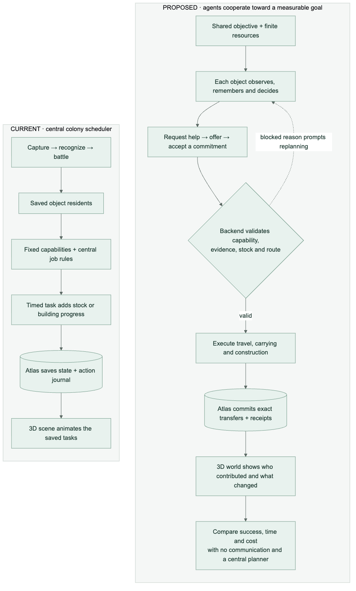
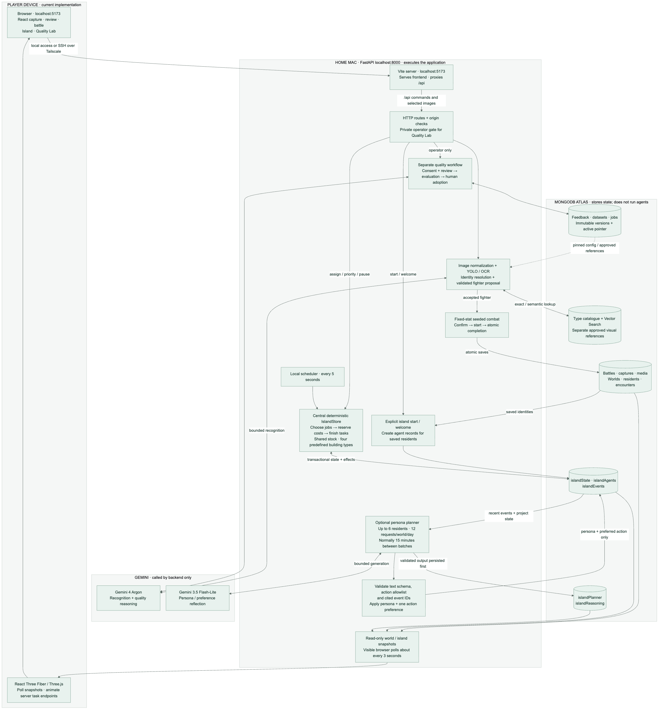
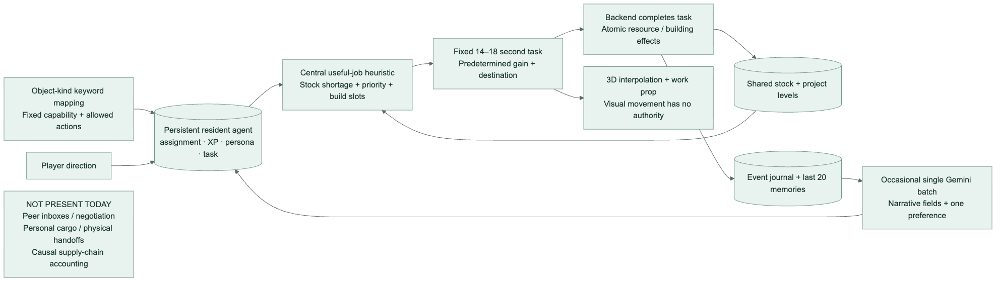
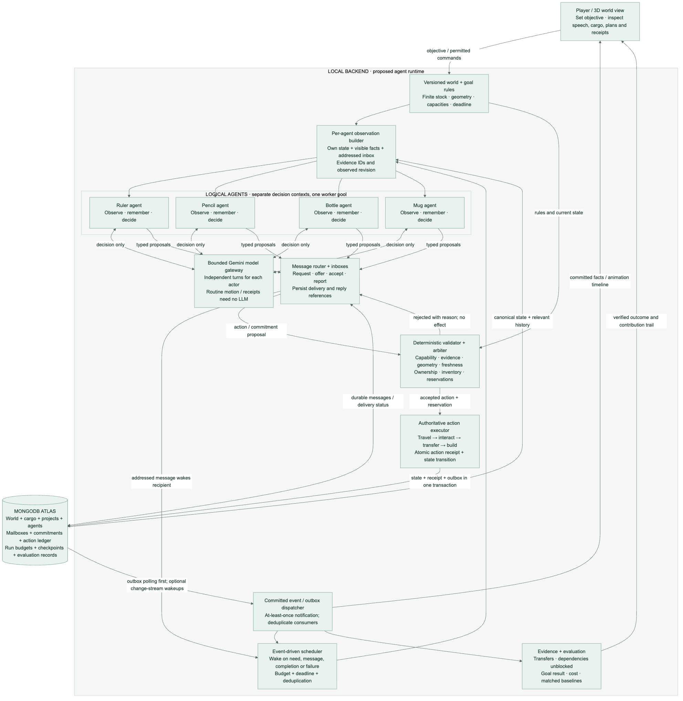
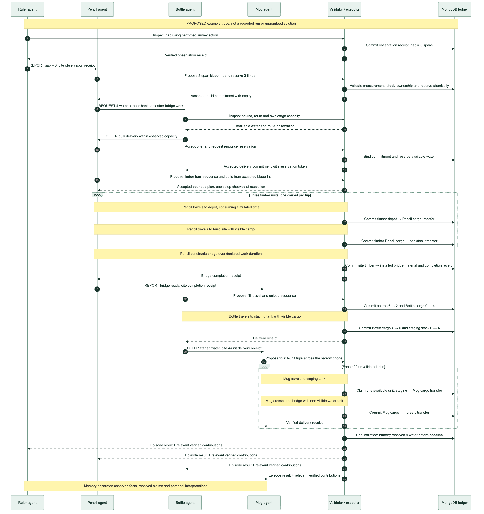
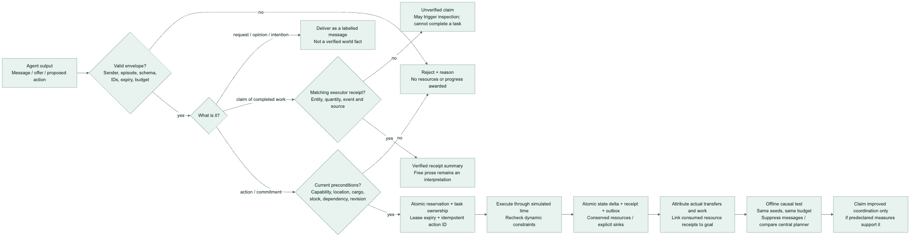
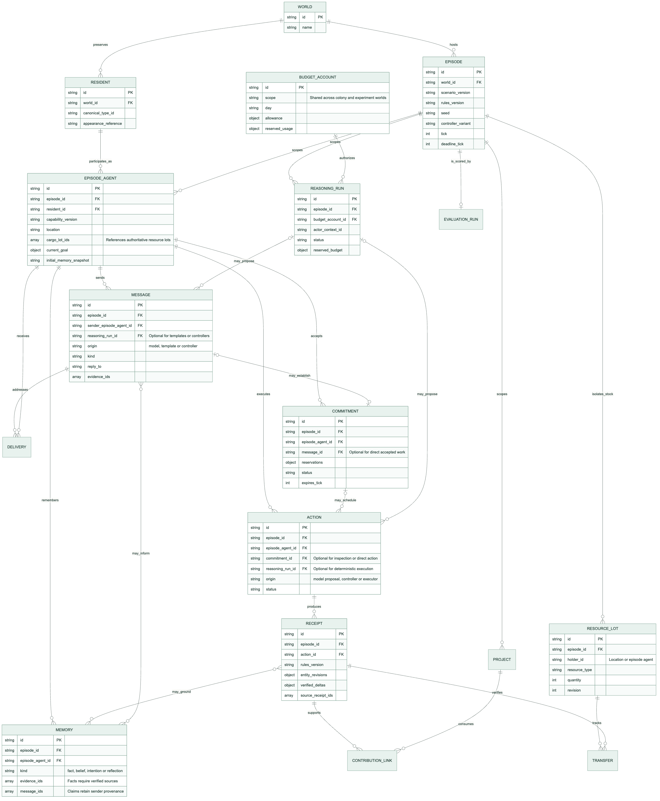

# Sketch Clash agent architecture and validation

> Implementation update, 24 October 2026: the two-island capability SDK, shared boards and receipt-backed contributions are now implemented. See [COLONIES_IMPLEMENTATION.md](COLONIES_IMPLEMENTATION.md) for the current system. This document retains its earlier audited snapshot and proposed physical-cargo experiment; those should not be read as current implementation claims.

**Design draft · 24 October 2026 · current implementation audited at `f1e986f`**

The current island performs useful *scripted* work, but its residents do not communicate or negotiate. A central scheduler chooses jobs; Gemini supplies personality text and one action preference. The next design should make an object's contribution traceable: **an observation leads to a request, a negotiated commitment leads to an executed action, and a verified result advances a shared objective**.

The proposed research question is: **Does bounded communication between persistent object agents improve cooperative task completion under scarce resources, compared with independent agents and a central planner?** A believable conversation alone would not answer that question.

This document contains the current system, proposed architecture, a concrete cooperative episode, message and action validation, persistent state, and the experiment needed to support a claim. Only documentation and diagrams were created for this design review. The proposed runtime has not been implemented or activated.

[Open the one-page comparison](architecture/00-architecture-overview.svg) · [Editable Mermaid source](architecture/00-architecture-overview.mmd)

## 1 Current system

[Open the full current architecture](architecture/01-current-system.svg) · [Editable Mermaid source](architecture/01-current-system.mmd)

The application runs on the home Mac. The MacBook accesses its localhost frontend through the existing SSH/Tailscale arrangement. React/Vite serves the interface on port 5173 and proxies `/api` to FastAPI on port 8000. Credentials stay on the backend. MongoDB Atlas and Gemini are external services; MongoDB does not execute resident agents.

| Part | What is implemented |
| --- | --- |
| Capture and review | Camera/upload normalization, local YOLO/OCR evidence, Gemini 4 Argon proposals, canonical object resolution, schema validation and human feedback/correction. |
| Recognition retrieval | Exact/alias lookup and Atlas Vector Search over catalogue descriptions. The separate consented visual-reference system requires approved cases and configuration. Neither is currently an island memory-retrieval system. |
| Battle and unlock | Seeded fixed-stat combat, server-owned results and atomic completion. Both participants may unlock one resident per canonical type. Repeated types preserve their original appearance and history. |
| Colony enrollment | Explicit start/welcome creates missing working-agent records for saved residents, up to 40. A completed battle does not silently enroll its new resident. |
| Colony execution | A local worker calls `advance` every five seconds. One central heuristic chooses 14–18-second jobs from allowed actions, stock shortages and construction priorities. Transactions reserve costs and commit completion effects. |
| AI reflection | One bounded Flash-Lite batch updates up to six residents' personas and preferred actions. Its per-world planner is capped at 12 requests per UTC day, normally 15 minutes apart. This is not an application-wide Gemini spending cap. It does not generate independent multistep resident plans. |
| Presentation | The visible browser polls about every three seconds. Three.js interpolates task endpoints and shows work props. Animation does not move resources or certify completion. |
| Quality workflow | A separate operator-gated path handles consented reviews, evaluation, bounded improvement candidates and human adoption. It does not control colony tasks or make gameplay feedback into model training. |

### What the current island loop actually does

[Open the island loop](architecture/02-current-island-loop.svg) · [Editable source](architecture/02-current-island-loop.mmd)

Current contribution is an accounting effect: a resident adds resources or construction work when its scheduled task finishes. This is real application state, but it is not yet a physical supply chain or negotiated teamwork.

| Current limitation | Why it matters for the next design |
| --- | --- |
| Capabilities come from object-name keyword rules. | A bottle is assigned water-related work by code; the system has not discovered its affordances through experiments. Unknown objects become general scouts. |
| Gathering credits a shared pool directly. | A visible crate is not personal cargo. There is no source → carrier → recipient inventory trail. |
| No peer inboxes or conversation protocol. | Residents do not request help, acknowledge a task, accept an offer or report to another resident. |
| One central useful-job heuristic allocates work. | The visible activity is not evidence of independent agents coordinating. Only the allowed `preferred_action` field affects that heuristic; motto and goal text are narrative. |
| Endpoint interpolation is the movement model. | There is no route graph, collision checking or proximity requirement that makes a delivery physically necessary. |
| Memories are recent event text plus reflections. | An existing event ID does not prove that every sentence of generated prose follows from it. |
| Four fixed buildings and a fixed discovery list. | The island does not yet design new structures or explore an unknown physical system. |

The useful foundation is already present: authoritative state, durable action IDs, transactions, bounded model requests, restart recovery, a working renderer and preserved object identities. The proposed system should reuse those boundaries.

## 2 Proposed agent environment

[Open the proposed architecture](architecture/03-proposed-agent-system.svg) · [Editable source](architecture/03-proposed-agent-system.mmd)

An agent is a persistent logical actor with its own observations, inbox, memory, current goal and decision context. Four agents can share one model gateway and one worker pool without sharing their entire private context. Each receives only the observations and messages permitted by the scenario. Its output is a bounded message or proposed action, and its recipient decides how to respond. A single model call that authors everyone's dialogue and plan remains a **centralized director**, useful as a baseline but not evidence of peer coordination.

The authoritative simulation remains independent of the models. It defines game rules, location, inventory, object capacity, action costs, elapsed time and objective completion. Agents can propose; only the simulation can validate and commit effects. The model never writes world collections directly and never supplies executable game code.

### Three different records

| Record | Meaning | Authority |
| --- | --- | --- |
| Agent message | “I can bring four water units.” A request, offer, intention or interpretation. | A statement attributed to its sender; not proof of stock, arrival or success. |
| Accepted commitment | A valid agent accepts a specific task, deadline and reservation. | The backend has checked current preconditions and recorded ownership. Completion is still pending. |
| Executor receipt | “Four water units moved from the source into this container.” | A committed, versioned simulation event with exact state deltas and provenance. This may support a factual completion statement. |

Human-readable speech should be generated from these structured records. Display “offer,” “accepted,” “blocked,” “delivered” and “unverified claim” distinctly. A friendly persona can change wording or preferences; it cannot make a false delivery count as complete.

## 3 A cooperative episode with a visible payoff

**Nursery Rescue** is the proposed first test. The crew must get four water units to a dry nursery across a gap before tick 90. One proposed tick represents one active-worker second, including time spent waiting for model responses or messages. Exact action durations must be fixed and tested before evaluation. Provider latency therefore affects success: record it, interleave controller conditions across run times and report wall-clock duration as well as simulation ticks. Explicit player pauses are disallowed in scored episodes; worker downtime is recorded separately and pauses the episode clock for every controller.

Initial resources are finite: six water units at a cistern and three timber units at a depot. A near-bank staging tank holds up to six water units. The gap is two or three spans depending on the scenario seed, and construction consumes one timber per span. The nursery needs four delivered units to recover. Finishing visibly greens the nursery and unlocks a growing area; failure leaves the objective incomplete with an observable reason.

These capacities and widths are **declared simulation rules**, not measurements inferred reliably from a photograph. They belong to the accepted game object specification and must be visible to the player.

| Resident in this example | Simulated affordance | Observable contribution |
| --- | --- | --- |
| Ruler | Fast, accurate survey action. | Produces a verified gap measurement that a valid blueprint can reference. Other residents may measure more slowly; communication is not an artificial mandatory key. |
| Pencil | Efficient marking/blueprint action. | Creates a persistent placement plan specifying span, required timber and dependencies. A valid plan supports construction; saying “I planned it” has no effect. Basic alternatives remain available to other residents at declared costs. |
| Bottle | Four-unit cargo capacity; width two. | Fills from finite source stock and unloads into the staging tank. It cannot cross a width-one bridge in this scenario. |
| Mug | One-unit cargo capacity; width one. | Carries staged water across the completed bridge and deposits it in the nursery. Each deposit has a conserved transfer receipt. |

All four residents have a basic build action and may carry one timber unit at a time while not carrying water. Timber must be fetched from the depot and deposited at the build site before installation. The example below has Pencil do that work after preparing the blueprint; planning alone never creates a bridge. The named roles are a useful solution, not a script the evaluator must force. Agents can discover alternatives, perform inspections and act without peer messages if the environment allows it.

A player can select a goal, alter priorities, pause, inspect evidence and introduce a defined disturbance, such as a blocked route. The environment should make water depletion, carried quantities, reserved timber, individual bridge segments and deadline visible. A rejected action should show its reason and declared time cost, rather than removing resources mysteriously.

### Example conversation and execution

[Open the complete sequence](architecture/04-coordination-sequence.svg) · [Editable source](architecture/04-coordination-sequence.mmd)

This is an illustrative trace, not a transcript of a run:

- Ruler: “The gap is three spans. Here is the survey result.”
- Pencil: “I can lay out a three-span bridge. I need three timber.”
- Bottle: “I can stage four water units, but I am too wide for the crossing.”
- Mug: “Once the bridge and water are ready, I can make four trips.”
- Executor: commits actual construction and transfer receipts as the actions finish.

Every request/offer references a goal and typed requirements. Agreements can fail if stock was reserved elsewhere, a route becomes blocked, a deadline expires or an agent becomes unavailable. The response is a recorded rejection, cancellation or replanning trigger—not fabricated dialogue claiming success.

### Conservation and meaningful contribution

At every committed state:

`6 initial water = source + staging + all carried water + nursery delivery + explicitly recorded loss`

A reservation reduces availability; it does not create or transfer stock. Timber must likewise remain accounted for as available stock, reserved stock, carried stock, installed bridge material or a declared loss. Don't count a reservation again as a separate physical quantity.

Track exact transfers, work and dependencies: Bottle supplied a lot; Mug consumed part of that lot to deliver water; those delivery receipts satisfied the nursery condition. Show each resident's delivered quantities, accepted work, dependencies unblocked and wasted effort. Do not use message count, eloquence or raw XP as evidence of useful contribution.

This ledger establishes provenance. To claim that a resident or message *caused better performance*, rerun matched scenarios with the relevant intervention removed or replaced. Do not double-count the same delivered water as four separate units of team benefit for every helper.

## 4 Validate messages and actions before effects

[Open the validation diagram](architecture/05-validation-and-evidence.svg) · [Editable source](architecture/05-validation-and-evidence.mmd)

A proposed message envelope contains `id`, `world_id`, `episode_id`, `sender_id`, recipients, kind, `goal_id`, `reply_to`, `observed_revision`, expiry tick, evidence IDs and a bounded typed payload. The application binds the sender from the executing actor context; a model cannot impersonate another resident by inventing a sender ID.

| Gate | What is checked | Failure behaviour |
| --- | --- | --- |
| Message admission | Identity, episode, allowed recipients/kind, payload bounds, references, rate limit, expiry and deduplication. | Reject or retain as undelivered; never execute a side effect. |
| Factual claim | Does an accessible executor receipt establish the claimed entity, quantity, action and time? | Mark unverified or require inspection. A model judging another model is insufficient proof. |
| Capability and geometry | Accepted game-object specification, reachable location, route width, interaction distance, cargo capacity and action type. | Return the precise blocking condition. No unearned progress. |
| Planning preconditions | Required observations, current stock, dependencies, revision, ownership and enough time to act. | Refresh affected observations and replan. Check the relevant entity revisions so unrelated world ticks do not invalidate every plan. |
| Reservation | Atomic claim of available units, task slots and commitment ownership, with an expiry. | One contender wins; losers receive a conflict result. Expiry releases reservations through application logic. |
| Execution and completion | Preconditions that can change, elapsed time, conservation, idempotent action ID and verified resulting state. | Abort or partially complete according to explicit rules, with a receipt for any real effect. |
| Memory write | Observation/receipt provenance, message provenance, scenario/rule version and whether the entry is fact, belief, intention or reflection. | Unsupported interpretations stay labelled beliefs; they do not enter the factual ledger. |

Quantity-bearing factual speech can be rendered from receipt fields to avoid embellishment. Free-text explanations and persona reflections remain model-authored interpretations even when they cite valid IDs. Display only evidence the observer is allowed to see; private observations must not leak through shared narration.

## 5 State and MongoDB responsibilities

[Open the proposed state model](architecture/06-proposed-state-model.svg) · [Editable source](architecture/06-proposed-state-model.mmd)

Keep the existing `worldCharacters` identity/appearance and battle history intact. Add a versioned episode model beside the existing free-play colony, rather than rewriting its saved economy in place.

The diagram is a logical model with illustrative fields, not a final collection schema. Persistent residents participate through separate episode-agent records; episode cargo and work cannot leak into another run. Reusing older verified memories must follow the declared memory policy, with the same initial-memory snapshot across compared controllers. The complete message envelope is specified in Section 4 even where fields are omitted from the diagram.

| Proposed storage | Purpose and invariants |
| --- | --- |
| Agent state / observations / memories | Identity reference, accepted capability version, own inventory/location, current goal, known facts and separated beliefs. Existing island-agent records may be referenced; scenario state is explicitly versioned. |
| Messages and inbox deliveries | Immutable message, per-recipient delivery/processing state, reply chain, expiry and evidence references. A unique consumer/message key makes repeated delivery harmless. |
| Commitments and reservations | Assigned work, acceptance, dependencies, stock reservation, owner lease, expiry and cancellation. |
| Resource lots and transfers | Finite stock and source-to-destination provenance. Every debit/credit belongs to a committed action receipt. |
| Action ledger and outbox | Immutable completion/rejection receipts, before/after revisions, rules version, exact deltas and a durable notification to dispatch. |
| Reasoning runs and worker state | Budget reservations, model/version, input-context references, status, usage, pending response and checkpoints. No provider call occurs inside a database transaction. |
| Evaluation records | Scenario seed/version, controller variant, aggregate budget, all action/message traces and result. Experiment worlds remain separate from the player's island. |

Use ordinary indexed queries and transactions first. Reserve/transfer state, write the receipt and insert its outbox notification atomically. The dispatcher and consumers must deduplicate even if notifications are delivered more than once. A change-stream wakeup is a later option; durable checkpoints and a polling recovery path remain necessary if resume history expires. Database TTL deletion is not a reliable commitment-release mechanism: the application must reconcile expiry before releasing resources.

The current Atlas Vector Search path is for recognition descriptions. Optional future memory retrieval can search long-term **verified** memories with world, agent, episode and rules-version filters. Exact inventory, balances and eligibility always come from authoritative queries, not vector similarity. Add text/vector/hybrid retrieval only if a retrieval evaluation shows it improves relevant-memory recall or task outcomes. Change streams, vector memory and hybrid retrieval are proposed additions here, not features activated by this document.

MongoDB executes database operations; a Python worker runs agent decisions and the simulation. Four logical actors do not require four continuously running model processes or four servers. For an initial local version, keep one world owner. If multiple workers are later introduced, require leases, fencing tokens and idempotent task claims before scaling.

## 6 Reasoning cost and recovery

Use model calls for decisions at meaningful boundaries: a new objective, an addressed request, a failed commitment, a newly discovered constraint or a relevant completion. Avoid invoking a model on every tick, footstep, receipt or social greeting. Routine motion and validated multi-step execution run in local code. Short factual reports can be generated from receipts without another model request.

A proposed initial *episode* budget is eight total decision requests across all residents, no more than two in flight, and at most 256 output tokens per decision, with a measured input/token allowance and deadline. These are starting design limits to test, not measured optimal settings or a promised price. A decision may submit a short bounded action sequence, such as four pickup/travel/deposit trips. The executor validates every step and stops on a failed precondition; no model-generated code is executed. Sequence-diagram arrows are protocol and execution events, not one model request each.

The current 12-requests/day ceiling belongs to the island planner for one world; recognition and quality calls have separate paths. **Do not silently increase that ceiling or create extra experiment worlds to bypass it.** The proposed gateway should enforce a shared colony-and-episode allowance across worlds. Until a different evaluation budget is explicitly configured, admit an episode only from the remaining allowance: one eight-request episode would consume most of a 12-request day. This shared gateway is proposed, not already implemented.

When the budget is exhausted, finish already accepted safe actions and visibly switch to a declared deterministic fallback or wait for the player. Mark that mode in evaluation records. Do not disguise fallback dialogue as fresh AI reasoning.

Persist a validated decision before applying it. Reapply a stored decision locally after interruption using stable action/message IDs. Keep unknown provider outcomes conservatively reserved and do not blindly repeat them. The proposed episode clock should pause when its worker is stopped; display downtime. Keep the existing colony's bounded catch-up separate so a timed challenge does not secretly complete or fail while its decision runtime is unavailable.

## 7 Validation and the white-paper claim

The hypothesis is **unproven**: communication may reduce duplicated work and improve responses to missing information, but it adds latency and cost. A good central planner may outperform the peer agents. The design should make that result possible and report it honestly.

### Compare controllers, not just dialogue styles

| Condition | Controller |
| --- | --- |
| Deterministic baseline | A fixed resource/route policy with no model calls. This is a cost and performance reference, not an equal-compute claim. |
| Independent agents without messages | Same object capabilities, model, memory allowance and aggregate reasoning ceiling as peer agents; no peer inboxes. Agents may inspect and observe the environment normally. |
| Central planner | One decision context allocates the same crew's work under the same aggregate token/call/time ceiling and action interface. It may combine observations available to the team. |
| Communicating peers | Separate actor contexts exchange bounded messages and negotiate tasks. Communication generation counts against the same total budget. |

First run a coordination-only condition with identical public observations to isolate decision structure. Then run a separate local-observation condition: sensor access, observation timing and the cost of sharing must be declared and audited. The central planner receives the union of team observations at the same timestamps, not hidden ground truth. A difference caused by extra information must not be described as a benefit of communication alone.

Freeze rules, controller settings, deadlines, metrics and aggregate budgets before the held-out runs. Use separate development seeds for tuning. Vary initial positions, gap size, source quantities, blocked routes, delayed messages and worker interruptions. Use paired seeds across conditions, repeat stochastic runs, retain failed/time-limited episodes and report uncertainty.

Under the existing allowance, the weekend deliverable is deterministic engineering checks and a small number of clearly labelled model demonstrations drawn from the remaining quota. It cannot establish statistical superiority. A later exploratory study with 30 held-out seeds, three repetitions and three model controllers would require 270 model-driven episodes—up to 2,160 requests at the proposed ceiling—plus development runs. That needs a separately configured study budget or a much longer schedule. Final study size must follow a power or precision analysis rather than treating 30 as sufficient by definition.

Primary outcome: fraction of episodes that deliver four valid water units before the deadline, without an invariant violation. Secondary outcomes: completion ticks with failures explicitly handled, useful delivered volume, material loss, travel/idle time, duplicated commitments, rejected/stale actions, and actual tokens/calls per episode and per successful objective. Report cost and success separately; a cheap system that usually fails is not efficient.

Predeclare the practical success improvement and the acceptable margin versus the central planner before running the final comparison. All resource-creation/duplicate-effect violations must be zero. If communication only improves perceived personality, report that as a separate human-rated presentation result, not better planning or productivity.

### Tests that distinguish contribution from theatre

- Suppress or delay selected message classes on matched seeds. Compare outcomes with the full protocol while keeping sensing and budgets recorded.
- Replace an agent capability with a standard generalist or remove a delivery commitment. Measure the change; retain resource-feasible control scenarios so impossible tasks do not manufacture a flattering result.
- Remove the reflection memory while keeping factual history, or replace factual history with recent observations only. Test whether memory helps rather than merely lengthening prompts.
- Feed stale offers, duplicate deliveries, forged senders, nonexistent receipt IDs and prompt-like text in messages. They must not bypass state authority.
- Restart between reservation, provider response, action execution and event delivery. Verify conservation, no repeated provider request after an unknown outcome, and no duplicated task effect.

A paper should publish scenario/rules versions, controller prompts, budgets, seeds, traces, exact outcome definitions and uncertainty alongside the screenshots. The earlier colony's passing engineering tests establish persistence and invariants for that implementation; they are not experimental evidence for this proposed coordination system.

## 8 Delivery order after architecture review

| Stage | Concrete result | Exit evidence |
| --- | --- | --- |
| 1 Environment authority | Finite stock, personal cargo, routes, capacity, resource transfers and the nursery objective. Keep current capture and original colony intact. | A deterministic controller can complete the task; conservation and replay tests pass. |
| 2 Evidence and communication | Durable typed messages, observations, commitments, receipts and visible speech/status. | A hand-authored controller exchanges real requests and produces traceable transfers. This verifies plumbing, not AI benefit. |
| 3 Bounded independent decisions | Separate resident contexts, event-driven turns, budgeted model gateway and failure recovery. | Actual model-authored proposals cause accepted or rejected actions; the trace identifies each actor and effect. |
| 4 Visible game loop | Cargo overlays, bridge segments, blocked reasons, deadline, green nursery payoff and evidence inspector. | A viewer can explain who helped, how, and what changed within a minute. |
| 5 Comparison and refinement | Fixed baselines, paired held-out scenarios, communication/memory ablations and usage reports. | Claim only the benefit actually measured; retain the simpler controller if coordination does not help. |

The strongest demo is a visible causal chain: **Ruler's measurement → Pencil's valid blueprint → committed bridge → Bottle's staged water → Mug's deliveries → flourishing nursery**. Every arrow should be inspectable evidence, while the agents remain free to choose a different valid solution.

## 9 Code anchors and research foundations

Current-code anchors, relative to the repository:

- `backend/app/main.py:create_app` — runtime startup, HTTP routes and service wiring.
- `backend/app/service.py:BattleService._recognize_registered` — versioned capture/recognition flow.
- `backend/app/repository.py:Repository.start_battle/finalize_battle` — authoritative combat and resident unlock.
- `backend/app/island.py:AFFORDANCES, _choose_action, _schedule, _complete` — fixed capabilities, heuristic policy, task effects and journal.
- `backend/app/island_api.py:IslandRuntime.loop` — five-second local worker and island control routes.
- `backend/app/island_planner.py:IslandPlanner._input/run/_apply` — bounded batch reflection and persona persistence.
- `src/components/WorldView.tsx` and `src/lib/island.ts:computeTaskPose` — snapshot polling and visual interpolation.
- `backend/app/quality_jobs.py:QualityWorker` — separate operator-driven quality jobs.

Research and infrastructure sources motivate parts of this design; none establish that this particular multi-agent island will improve productivity:

1. Park et al., **Generative Agents** (2023): memory, retrieval, reflection and planning support coherent simulated characters. The paper's believability results and documented memory embellishments motivate separating facts from interpretations here. [Primary paper](https://arxiv.org/html/2304.03442v2).
2. Yao et al., **ReAct** (ICLR 2023): interleaving environment observations with reasoning and executable actions supports a grounded decision loop. Its evaluated task results are not a demonstration of peer-agent superiority. [Primary paper](https://arxiv.org/html/2210.03629v3).
3. MongoDB, **Transactions**: supports atomic application state changes across documents; the application still defines the resource invariants. [Official documentation](https://www.mongodb.com/docs/manual/core/transactions/).
4. MongoDB, **Change Streams**: supports notifications for committed database changes and resumable consumption subject to retained history; it does not execute agents or provide application-level exactly-once effects by itself. [Official documentation](https://www.mongodb.com/docs/manual/changestreams/).
