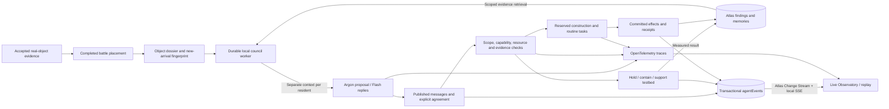

# Persistent object councils and the live Observatory

The application remains local: React/Vite on 127.0.0.1:5173, FastAPI on 127.0.0.1:8000. Gemini is called from Python; MongoDB Atlas stores durable state. Open `/#/observatory` to inspect actual activity and `/#/islands` → Discussion for model-authored conversations and experiments.

## From an object to a participating resident

An accepted fighter reaches its winner/loser shore through an immutable battle placement. Its first accepted visual evidence is retained in a dossier. Observed features, synthetic physical assumptions, hypotheses and tested findings are separate fields. A new resident changes the roster/capability fingerprint, reopens blocked research and triggers a council. A roster change during a model call invalidates its stale proposal before it can change island state. Existing work and paid reservations remain intact.

## Runtime and authority

Each council selects up to three residents and allows at most six separate turns. The model receives actual preceding messages, its own capabilities, island resources and evidence. At least two distinct residents must explicitly support the same feasible project; a single-resident island can make a solo choice. The executor never supplies missing model votes. No agreement remains an honest outcome. Manual project overrides remain available.

The local worker is long-running; each Gemini call is finite and uses the official Interactions API with `store=False`. Pending turns, responses and session progress survive restart. Known throttling receives a visible cooldown and bounded retry; ambiguous transport outcomes are retained rather than blindly duplicated. Provider project limits still apply. `COLONY_REQUESTS_PER_DAY=0` removes the previous application daily ceiling. Walking and rendering do not call Gemini.

## Experiments and construction

Agents can propose three analytical experiment families: holding against wind, containing/transporting water, and spanning/supporting loads. The backend measures outcomes using geometry and numeric properties, not canonical object labels or prices. Physical parameters are authored simulation assumptions, not measurements of real objects.

Successful evidence is contextual: participants, arrangement, conditions and simulation version must match. Failed tests remain useful evidence. New conditions or new collaborators require another test. Tested blueprints use bounded beam/panel/vessel/connector parts; costs, placement and benefits are server-derived. Construction enters the normal reserved-work lifecycle. A successful prototype must also cover the declared normal workload before it can become a production construction: hold at wind 1/load 1/duration 10, contain volume 0.3 over distance 2, or support span 0.6/load 0.2. Easier tests remain contextual findings but earn no general production bonus. Completion gives a capped benefit on eligible future tasks within that operating envelope, rather than minting resources from model text.

Atlas Vector Search retrieves conditioned findings. Returned IDs are resolved against authoritative, same-island records. Missing indexes or unavailable embeddings explicitly fall back to exact evidence retrieval. Simulation learning never rewrites accepted object identity or approved recognition references.

## Observability and persistence

The Observatory combines real resident portraits, Gemini activity, the shared board, simulator and Atlas memory. Packets are triggered by saved events; pending inference and committed results are distinct. Live and Replay are labelled. Replay does not execute actions.

Domain events are written in the same transaction as the corresponding board/state effect. A single backend Change Stream fans out through SSE, with sequence-based reconnect and deduplication. Cursor expiry or a slow browser triggers an explicit resync; a stream outage falls back to labelled polling of committed events.

OpenTelemetry instruments FastAPI, PyMongo and agent operations. Sanitized spans and minute aggregates are batch-exported to Atlas, suppressing exporter self-instrumentation. Credentials, captures, raw query statements and full prompts are excluded. Operational traces/events expire after seven days and metric aggregates after thirty days. Gameplay receipts and knowledge are independent durable records. MongoDB is the state store, not a hosted inference runtime or a native OTLP collector.

Read APIs: `/api/colonies`, `/api/colonies/{side}/knowledge`, `/api/colonies/{side}/experiments`, `/api/colonies/councils/history`, and `/api/observatory/{events,stream,sessions,metrics,traces/{trace_id}}`.

## Verification

Run `npm run test:backend`, `npm run test:island-scene`, `node scripts/verify-assembly-scene.mjs`, and `npm run build`.

`backend/scripts/evaluate_colony_memory.py` runs isolated matched cases. The saved `memory-evaluation.json` demonstrates evidence reuse and mandatory retesting after changed loads or new participants. It evaluates fixed-policy memory plumbing, not Gemini intelligence or general physical understanding. Provider fixtures test multi-actor replies, explicit agreement, restart safety and arrivals during inference. Live checks are reported separately from these deterministic fixtures.

## Verification recorded on 24 October 2026

- Full backend suite: **256 passed, 2 skipped**. The skipped tests require the separate opt-in real-MongoDB integration flag; live Atlas checks below were performed independently.
- Production frontend build, TypeScript, island animation/geometry checks and assembly presentation checks passed. The existing large Three.js bundle warning remains.
- Live Atlas Change Stream and SSE reconnected after a local backend restart. Recent committed task events had 62–84 persisted trace spans within approximately 5–6 seconds; the new exporter reported zero failures or drops during that check.
- Desktop and 390-pixel mobile Observatory views were checked without horizontal overflow. Events, saved session replay and trace inspection use actual stored records.
- Genuine multi-resident agreement, recovery, arrival invalidation and research-to-construction behavior were verified with isolated deterministic provider fixtures. No fixture dialogue was inserted into the live islands.
- Live Gemini limitation (updated after authorized tiny probes): all 12 tested text models, including Argon, Flash and Flash Lite, returned HTTP 429 with Google's explicit monthly-spending-cap message. The raw probe responses are preserved; Argon failed through both Interactions and generateContent. The key is verified against Encode London-3446, whose AI Studio Spend page says spend caps are unsupported for its internal billing account. The discrepancy remains unresolved; evaluations stay paused. See [the response and configuration audit](../troubleshooting/gemini-2026-10-24.md).
