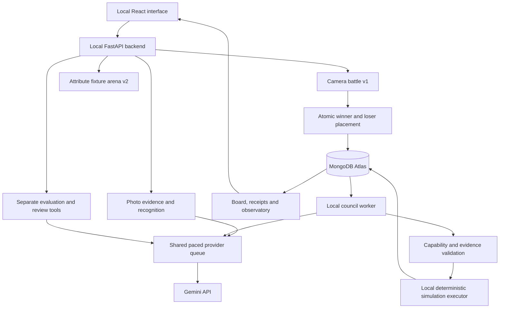

# Sketch Clash audit findings and repair plan

The frontend polish is implemented and pushed. The cat and dinosaur have been replaced by Graphite the pencil and Kiln the mug in the homepage and cinematic demo, retaining the original paper, ink, coral and mint style. The homepage explains choosing an object, seeing why it wins, and following the island crews. Mobile spacing and the Observatory button’s accessible name were improved.

The next priority is trustworthy agent evidence and reliable recovery. This audit identifies **13 actionable findings: six P1 and seven P2**. No P0 issue was confirmed within the reviewed scope. The existing tests pass, but some tests explicitly accept behavior that produces misleading UI or permanently stops automatic councils. Passing tests alone do not establish that the whole experience is reliable.

This is a repair plan for review. The broader repairs below have **not** been implemented. No new semantic-analysis service, agents or paid evaluation runs were added.

## Baseline and operating state

- Reviewed implementation: `9f85e0f`, following `53682a3`, on `main`.
- Frontend commit: `9f85e0f` — Polish object-themed homepage and replace animal demo mascots. Pushed to the existing GitHub repository.
- Runtime check: Atlas connected; gameplay Gemini enabled; saved pace **Slow**, one dispatch per minute; evaluation batches **paused**.
- Council planner: enabled, `auto_blocked=false`, an active council present at the final read. Winner Island retains its separate pause; Loser Island remains active.
- No backend restart, billing change, evaluation launch, explicit provider probe or live-world test mutation was performed for this audit. Normal authorized gameplay continued in the background.
- The [audit sequence](2026-10-24-audit-plan.md) defines the scope and severity criteria.

## Current architecture and product boundaries

MongoDB stores world state, histories, council messages, experiments, receipts and controls. The workers and simulation execute in the local backend; Atlas does not itself host the agent processes. Gemini supplies bounded proposals and public dialogue. The executor owns validated effects.

There are still three distinct battle experiences:

| Experience | Current behavior |
| --- | --- |
| Camera battle | Real recognition, human review, three-class v1 combat, persistent island placement. |
| Object fixture arena | Authored attributes, bounded sample-price effects, conditional weaknesses and explained v2 outcomes. Saved practice matches do not add live island residents. |
| Watch demo | Scripted cinematic object showdown. No recognition or island unlocks. |

The v2-to-camera gap is a documented product limitation, not a broken integration introduced by this polish. A new live attribute/price pipeline would be feature work. Keep the mode labels explicit for the demo instead of claiming every photographed object already uses v2.

## Findings

### A1 — P1 — A verified board report can display an invented contribution

**Sources:** `backend/app/colonies.py:1082`, `:1125`; `src/components/ColoniesView.tsx:117`, `:124`, `:164`; `src/components/ColonyResearch.tsx:34`; `backend/tests/test_colonies.py:233`.

The backend correctly checks ownership of a completion receipt and saves its real description in `text`. It also saves arbitrary model prose in `interpretation`. Several board views and the published event prefer that interpretation while retaining the verified receipt association.

**Proof:** An isolated pencil receipt added three ideas. A report citing it with “I generated 999 energy.” was accepted; that sentence is what the board presentation chooses. The existing report test similarly accepts “I invented unlimited water.” The actual stored resource delta remains correct; the misleading part is the apparent verified claim. The council transcript uses the real receipt text, so views can disagree.

**Repair and acceptance:** Use executor facts as the primary text for reports everywhere. Any model commentary remains separately labelled as unverified. One contradictory report must show the real delta in the board, research view, quoted replies and Observatory, without lending its commentary a verification badge.

### A2 — P1 — Shared requests overwrite another agent’s provenance

**Sources:** `backend/app/colonies.py:611`, `:1116`; `backend/app/colony_planner.py:610`.

The resource-request helper reuses an existing open request for the same resource/project. Applying a later agent’s request then overwrites that row’s run, session and provenance, while its actor remains the original agent.

**Proof:** Two isolated agents requested the same resource/project. One board ID remained, still owned by the first actor, but its run/session changed to the second actor’s turn. The second turn’s conversation entry is then filtered out because the actor does not match.

**Repair and acceptance:** Separate a shared work request from immutable speaker messages. Keep one work item, preserve its original attribution, and create a correctly owned acknowledgement referencing it. Both turns must remain visible; replay must not duplicate either the request or messages.

### A3 — P1 — An invalid proposal can stop both islands’ automatic discussion

**Sources:** `backend/app/colony_planner.py:18`, `:597`, `:691`.

Ordinary validation failures such as `capability_denied`, `invalid_report_evidence`, `invalid_proposal_evidence`, `request_not_found` and `self_claim` are outside the recoverable-error set. A rejected action therefore sets the shared planner’s `auto_blocked` indefinitely.

**Proof:** A fake provider proposed watering for an actor without that capability. No effect was applied, correctly, but after advancing the isolated clock by 500 seconds, a new automatic council still failed with `planner_not_due`. The current test explicitly expects this permanent block.

**Repair and acceptance:** Retain strict rejection but feed it back into a bounded session/actor retry policy. An invalid proposal produces zero effects; a subsequent eligible discussion can proceed after backoff. Repeated bad proposals must have a bounded circuit and a visible reason, without repeatedly calling Gemini. Reserve global blocking for genuinely uncertain requests, broken invariants or operator intervention.

### B1 — P1 — Evaluation pause misses requests already waiting in the queue

**Sources:** `backend/app/recognition.py:97`, `backend/app/quality_jobs.py:327`, `backend/app/quality_references.py:141`, `backend/app/provider_queue.py:304`.

The durable evaluation pause is checked when reserving budget, before the request waits for shared pacing. The later dispatch checks the global AI pause, but does not recheck the evaluation-specific pause or cancellation.

**Proof:** With a real evaluation budget and a fake provider, evaluation was paused after reservation but before the queue was released. The fake provider still observed `paused_when_dispatched=true`.

**Repair and acceptance:** Recheck evaluation pause, cancellation and deadline immediately at admission for recognition, improvement and reference embedding. Queued reservations are distinct from sent requests. Pausing evaluation while these requests wait must result in zero subsequent fake SDK calls, while gameplay remains enabled. Current evaluation pause remains in place; this finding is about the transition race, not evidence that batches are running now.

### B2 — P1 — Restart resets the global daily request allowance

**Sources:** `backend/app/provider_queue.py:212`, `:232`, `:288`, `:330`; `backend/app/main.py:49`; `backend/app/config.py:33`.

Rolling dispatch timestamps are process-local. A fresh backend starts with a new allowance. The separate durable council-only ceiling defaults to disabled. This limitation is documented in code, but means the global cap is not a durable spending safeguard.

**Proof:** An isolated queue rejected a request at its cap; recreating the queue permitted another request immediately. No actual excess charge was observed or inferred.

**Repair and acceptance:** Store atomic dispatch reservations and rolling usage in Atlas across all request categories. Preserve conservative accounting for uncertain responses. Exhaust the allowance, restart against the same test store and confirm that no new request is admitted until expiry; concurrent admissions must not exceed the allowance.

### B3 — P2 — Temporary local admission limits permanently block councils

**Sources:** `backend/app/provider_queue.py:281`; `backend/app/colony_planner.py:431`, `:566`.

Local daily-cap and queue-full errors are non-retryable. The planner interprets them as terminal failures and persists `auto_blocked=true`, even when capacity later returns.

**Proof:** After exhausting a one-request fixture cap and advancing more than 24 hours, queue allowance returned to one but the planner stayed blocked. Only one fake provider invocation occurred.

**Repair and acceptance:** Represent local admission deferral separately from provider failure, with a resume time. Automatically resume once allowance returns, exactly once and within the global pacing rules. Queue-full recovery needs equivalent coverage.

### B4 — P2 — Restart during queue wait creates false provider uncertainty

**Sources:** `backend/app/colony_planner.py:374`, `:456`, `:503`, `:555`, `:682`.

The planner marks a turn running before it reaches provider admission. Recovery treats a running turn without a saved response as potentially sent, even when it was only waiting for Slow pacing.

**Proof:** A cloned in-memory store contained `council.started` and `model.queued`, zero provider calls and no `model.requested` event. Recovery marked it uncertain and blocked automatic councils.

**Repair and acceptance:** Persist separate queued, dispatching, response-received and applying states. Restart at each boundary. Undispatched turns may resume safely; genuinely uncertain dispatches retain conservative handling. Saved responses must never be purchased or applied twice.

### F1 — P1 — Delayed Quality Lab responses can target the wrong reviewed job

**Sources:** `src/components/QualityConsole.tsx:147`, `:156`, `:203`.

`loadJob` checks whether the component is mounted, but not whether its response still belongs to the selected job. A slow A response can overwrite B’s details while the selector still says B. Rejection uses the displayed detail’s ID.

**Proof:** The unchanged callback ran in an isolated Node VM with deferred mocked requests. Resolving B first and A last produced `selectedJob=B`, `detail.job.id=A`, and A’s comparison pair.

**Repair and acceptance:** Cancel superseded loads, use a selection generation, publish matching details/comparisons atomically and guard mutations against ID mismatch. Repeat the A/B response ordering test, including overlapping polling; only B may remain actionable.

### F2 — P2 — Blinded comparison labels can appear before review

**Sources:** `src/components/QualityConsole.tsx:151`, `:193`, `:203`.

Details publish before comparisons finish loading. The initial empty `pairs` array makes `pairs.every(...)` true, temporarily revealing version-labelled results; a failed comparison request can leave them available.

**Proof:** Source control flow and empty-array evaluation establish the exposure window. No live review was submitted.

**Repair and acceptance:** Use explicit comparison loading/error state. Labelled results require a successful comparison response and required reviews. Slow or failed comparison retrieval must never satisfy that gate; a real zero-pair response needs a deliberate policy.

### F3 — P2 — Top-level navigation does not consistently survive refresh

**Sources:** `src/App.tsx:137`, `:235`, `:245`, `:250`, `:254`.

Several island and quality entry points update React state without updating the hash route.

**Proof:** In the browser, the home “The Islands” button opened the twin-island screen while the URL remained `/`. Reload returned to the homepage.

**Repair and acceptance:** Route all top-level navigation through one helper, including Quality. Verify refresh and Back/Forward for each view, while preserving active-round exit/recovery behavior. Outstanding round responses must not overwrite a newer route.

### F4 — P2 — Observatory can display stale data under another island

**Sources:** `src/components/Observatory.tsx:119`, `:141`, `:330`.

Failed snapshot, metrics and session polls are silently ignored. Switching island retains old results until a new fetch succeeds. A failure can therefore leave Winner data under the Loser filter; the independent event stream can still say “ENGINE CONNECTED.”

**Proof:** Source review establishes retained state and ignored failures; this delayed-network scenario was not exercised against the live service.

**Repair and acceptance:** Bind data to the island/filter and successful fetch time. Clear mismatched data or explicitly mark it historical. Reject a Loser fetch after displaying Winner metrics; Winner values must never appear as current Loser results. Stream connectivity and data freshness need separate status.

### F5 — P2 — Reduced motion still animates several battle effects

**Sources:** `src/components/BattleArena.tsx:45`, `:117`; `src/components/BattleArena.css:14`; `src/main.tsx:10`.

The existing preference handling reduces fighter motion and flashes, but impact rings, hit text, swipes and the crown retain Motion transforms. The CSS reduction does not disable inline Motion animation.

**Proof:** Source inspection of both rendering branches and styles. Automated replay checks pass, but do not establish that every rendered effect respects the preference.

**Repair and acceptance:** Apply the preference consistently to decorative movement while preserving health, damage and winner information. Verify both cinematic and fixture playback with reduced motion enabled, including reveal and victory transitions.

### F6 — P2 — Quality Lab does not show the saved evaluation pause

**Sources:** `src/components/QualityConsole.tsx:13`, `:201`; `backend/app/quality.py:187`.

The backend returns evaluation pause state, but the frontend omits it and may offer eligible batch/reference actions that the server then rejects. Gameplay AI state and evaluation state are separate.

**Proof:** API/schema/rendering comparison; the live read confirmed evaluation pause is currently true. No batch submission was attempted.

**Repair and acceptance:** Show the saved pause and disable dependent submissions. The UI must clearly allow gameplay to be enabled while evaluations remain paused. Do not automatically resume evaluations as part of this repair.

## Repair sequence and commit boundaries

Effort estimates are planning ranges, including focused tests, not delivery promises. Keep each batch reviewable and push after its acceptance checks pass.

| Order | Batch and scope | Acceptance milestone | Estimate |
| --- | --- | --- | --- |
| 1 | **Board truth:** A1; one shared report presentation policy for all views/events. | Contradictory prose never appears as a verified effect. | 1–2 hours |
| 2 | **Message attribution:** A2; separate deduplicated work requests from speaker messages. | Original provenance survives; both turns remain visible; replay is idempotent. | 2–3 hours |
| 3 | **Recoverable discussion:** A3 and B3; classify rejected proposals and local admission deferrals. | Valid work resumes with bounded backoff; strict validation still blocks effects. | 2–4 hours |
| 4 | **Dispatch lifecycle:** B4; explicit durable queue/dispatch/response/application phases. | Restart-boundary tests preserve work without false uncertainty or duplicate effects. | 2–4 hours |
| 5 | **Evaluation admission:** B1. | Paused queued evaluations never dispatch; gameplay continues at Slow. | 1–2 hours |
| 6 | **Durable request allowance:** B2; shared atomic Atlas admission ledger. | Allowance survives restart; concurrent admissions and uncertain outcomes stay bounded. | 3–5 hours |
| 7 | **Review integrity:** F1 and F2. | Delayed responses cannot change the selected job; blind review stays blind. | 2–3 hours |
| 8 | **Operational clarity:** F4 and F6. | Freshness and filter ownership are explicit; evaluation pause is visible. | 1–2 hours |
| 9 | **Navigation and motion:** F3 and F5, separate commits if independently completed. | Refresh/history work; reduced-motion rendering passes a browser walkthrough. | 2–3 hours |
| 10 | **Final demo rehearsal and documentation.** Update stale demo labels, distinguish v1/v2 and remove obsolete outage assumptions. | A camera/fixture/island/board/Observatory walkthrough matches actual behavior. | 1–2 hours plus device access |

For a short hackathon polishing window, start with batches 1–4: the board must be trustworthy and agent discussion must recover. Keep evaluation batches paused. Before enabling evaluations, complete batches 5 and 7. Treat batch 6 as required before presenting the daily guard as restart-safe or increasing unattended request volume. Do not accelerate requests to hide stalled automation.

## Live semantic analysis without expanding the product

The useful question is: **Does an agent’s public proposal lead to validated, useful work, and what changes its plan?** Existing records already support much of this:

- `kind`, `reply_to_id`, `session_id` and `run_id` link actual messages and turns.
- Structured decisions, project IDs and validation results separate proposals from accepted actions.
- Experiment predictions and outcomes expose tests that support or challenge a hypothesis.
- Completion receipts establish resource deltas, work and costs.

After A1 and A2 are fixed, a small board presentation pass could expose **proposed → supported or rejected → tested → completed**, with “no completed effect linked” when that is the truth. A changed plan should link to the recorded rejection, experiment or missing resource; an inferred link must be labelled as inferred. Counts of accepted/rejected proposals, zero-output tasks and completed work can be computed from existing records without another model call.

This is analysis of public intent and observed outcomes. It is not access to private model thoughts, evidence of a subconscious, or proof of general physical understanding. Existing vector retrieval concerns experiment evidence, not a live conversation-semantics engine. Defer a new classifier, conversation embeddings, sentiment scores and extra Gemini calls. The immediate semantic polish is making the existing evidence accurate and readable.

## Validation and coverage

| Check | Result and limit |
| --- | --- |
| Production build | Passed TypeScript and Vite. The separately loaded WorldScene chunk is about 1,007 kB raw / 267 kB gzip and triggers a size advisory. This is a profiling target, not a measured performance failure. |
| Backend suite | **377 passed, 2 skipped**, in 114 seconds. The skipped tests require an explicitly enabled real MongoDB integration environment. Eight dependency/deprecation warnings remain. |
| Battle replay checks | Passed timeline, authoritative health/outcome, replay, decision and hidden-page timing checks. |
| Island scene and geometry | Passed bounded travel, rigid proportions, state preservation, identity mapping and 64,908 finite pose samples. |
| Playground, receipts, image input and assemblies | All existing checks passed. Image tests cover input validation, not a physical webcam. |
| Frontend visual check | Homepage inspected at desktop and mobile widths; mobile card/step layout corrected. New objects verified in the cinematic battle. Viewport override reset afterward. |
| Isolated defect reproductions | Provider pause/admission/restart cases, request provenance, contradictory reports, invalid-action recovery and Quality response ordering used fake providers or memory stores. |
| Current tracked credential-pattern check | No Google API key match. Credentialed Mongo URI matches were a redaction-test fixture and a setup-script template. This narrow check is not a full secret-history or vulnerability audit. |
| Runtime state | Read-only health, pacing, evaluation and council checks confirmed Atlas, Slow gameplay and paused evaluations. |

Reviewed areas include config and redacted diagnostics; provider queue and controls; uploads and recognition; quality jobs/reviews; Mongo transaction paths; battle finalization; agent SDK, councils, experiments, learning and receipts; frontend navigation, camera cleanup, arena, islands, board, Observatory, quality and WebGL lifecycle; scripts, lockfiles and documentation.

Positive safeguards worth preserving: atomic battle completion and island placement, majority/snapshot Mongo transactions, idempotent identities, capability and population revalidation, receipt-based resource effects, bounded price effects, image metadata stripping and limits, server-only credentials, operator-gated evaluations, and hidden-page battle timing.

Not exercised in this pass: fresh Atlas failover/concurrent-process tests, physical MacBook camera capture, live recognition accuracy, new paid model evaluations, attack testing, historical secret scanning, dependency advisory databases, a screen-reader walkthrough or GPU profiling. The two integration skips and these boundaries should remain explicit in demo/readiness claims.

## Proposed next milestone

Complete the board-truth and attribution repairs first, then the bounded recovery fixes. Show one traceable conversation where a proposal is rejected or revised, a valid action finishes, and its actual receipt appears consistently across the board and Observatory. That is a stronger polish milestone than adding another agent or a new analytics subsystem.
